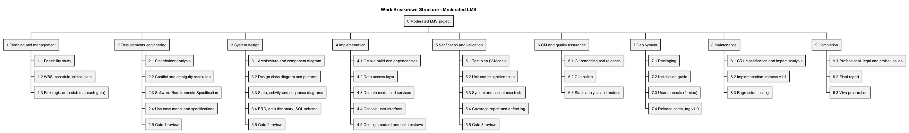
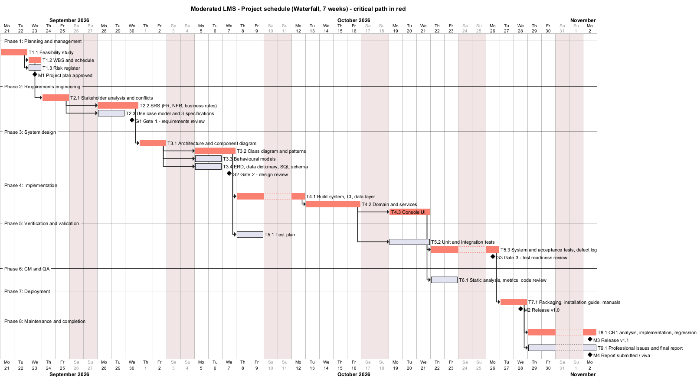

# Project Management Plan

**Project:** Moderated Learning Management System
**Process model:** Waterfall with V-Model verification and validation, three formal phase gates
**Duration:** 7 weeks (Mon 21 Sep 2026 - Fri 6 Nov 2026; submission 7 Nov 2026)
**Team:** one developer (the student), who also acts as tester, CM manager and technical writer; supervisor as reviewer at the gates.

## 1. Feasibility study

### 1.1 Technical feasibility
| Question | Assessment |
|----------|------------|
| Can the required functions be built with C++17, CMake and SQLite? | Yes. SQLite provides transactional storage in one file with no server, which suits offline use. The C++ standard library covers the rest; the only additional library is the Argon2 reference implementation for password hashing. |
| Can it run on the school's old computers? | Yes. A console program with an embedded database needs a few MB of RAM plus 19 MiB briefly during password hashing. Measured login time is 56-153 ms (two runs); the 800-student data set is below 5 MB. |
| Are the skills available? | C++ OOP, SQL and UML were covered in earlier modules. The riskiest new areas (CMake dependency management, CI, password hashing) are handled early (risks R1, R4). |
| Tooling | All tools are free: GCC/Clang/MSVC, CMake, GoogleTest, cppcheck, clang-tidy, lizard, gcovr, PlantUML, Git and GitHub Actions. |
**Verdict: feasible.** Main technical risk: an unfamiliar or missing toolchain on the development PC (this happened; see R1).

### 1.2 Operational feasibility
Teachers "are not IT experts": numbered text menus, one screen per task, and manuals written per role. The process matches how the school already works (lecturer marks, HoD checks) but adds traceability. The main operational risk is that one shared computer becomes a queue at deadlines; this is mitigated because submitting takes under a minute, and it is recorded as a limitation (future client/server version). **Verdict: feasible** with training (one short session per role using the demo data).

### 1.3 Economic feasibility
| Item | Cost (LSL) |
|------|-----------|
| Development: 7 weeks x ~20 h at a notional student rate of LSL 50/h | 7 000 (in-kind) |
| Software licences | 0 (open-source tools; SQLite public domain; Argon2 CC0/Apache-2.0) |
| Hardware | 0 (existing school computer) |
| Backup media (USB drives) | 300 |
| Training (2 h per role, staff time) | ~800 (in-kind) |
| **Cash cost to the school** | **~300** |

Benefits: time saved in manual mark collation and late-penalty calculation (estimated 1-2 h per lecturer per assignment); fewer disputes because every change is traceable; no subscription cost compared to hosted LMS products (which also fail the offline requirement). **Verdict: economically feasible**, with a very low cash outlay.

### 1.4 Legal feasibility
The system processes learners' personal data (names, work, marks). Under the **Lesotho Data Protection Act 2011** the school is the data controller and must process data lawfully, for a specific purpose, keep it secure and accurate, and retain it no longer than necessary. The design supports this: role-based access, hashed passwords, audit trail, local storage only (no cross-border transfer), and no data beyond what assessment needs. All third-party components have permissive licences (SQLite public domain, Argon2 CC0/Apache-2.0, GoogleTest BSD-3 for tests only). **Verdict: feasible**, provided the school adopts the operating measures in the professional-issues section (retention, backups, physical security of the PC).

### 1.5 Schedule feasibility
The work breakdown below totals 36 working days of effort planned across 35 working days with parallel activities; the critical path is 33 days, leaving 2 days of float before the deadline. Scope is protected by MoSCoW: Could requirements (notifications) are dropped first if the schedule slips. **Verdict: feasible but tight**, so risk R2 (schedule overrun) is rated high and monitored weekly.

### 1.6 Recommendation
**Proceed.** The project is technically, operationally, economically and legally feasible. It is recommended that (a) a single-computer offline architecture with SQLite is used, (b) the toolchain and CI are set up in the first implementation days, and (c) Could requirements are treated as optional scope.

## 2. Work Breakdown Structure

| WBS | Work package | Deliverable | Effort (days) |
|-----|--------------|-------------|--------------:|
| 1 | Planning and management | Project management plan, risk register | 4 |
| 2 | Requirements engineering | Stakeholder analysis, SRS, use case model | 5 |
| 3 | System design | Software design document (architecture, UML, patterns, database) | 7 |
| 4 | Implementation | Source code, build guide, coding standard | 10 |
| 5 | Verification and validation | Test plan, automated tests, results, coverage, defect log | 6 |
| 6 | CM and QA | Branching strategy, CI, static analysis, metrics, code review | 2 |
| 7 | Deployment | Deployment diagram, installation guide, user manuals, release notes, v1.0 | 2 |
| 8 | Maintenance | CR1 analysis, v1.1, regression results | 3 |
| 9 | Completion | Professional issues, final report, viva preparation | 3 |

## 3. Schedule (Gantt chart)

Source: [`docs/diagrams/gantt.puml`](../diagrams/gantt.puml). Weekends are non-working days.

### 3.1 Dependencies (finish-to-start)
FS -> WBS -> SA -> SRS -> ARCH -> CLS -> IMP1 -> IMP2 -> IMP3 -> ST -> DEP -> CR1; SA -> UC; ARCH -> BEH, DBD; CLS -> TP; IMP2 -> UT; IMP3 -> QA; DEP -> REP.

### 3.2 Critical path
**Feasibility -> WBS -> Stakeholder analysis -> SRS -> Architecture -> Class design -> Build system/data layer -> Domain and services -> Console UI -> System testing -> Deployment -> CR1** (shown in red). Any slip on these tasks delays the final release. Non-critical tasks (risk register, use cases, behavioural models, ERD, test plan, unit tests, QA, report writing) have float and are the first place to absorb problems.

### 3.3 Milestones and phase gates
| ID | Milestone | Planned date | Exit criteria |
|----|-----------|--------------|---------------|
| M1 | Project plan approved | 23 Sep | Feasibility, WBS, Gantt, risk register reviewed |
| G1 | **Gate 1 - requirements** | 30 Sep | SRS with >= 12 FR and >= 6 measurable NFR, MoSCoW; 3 fully dressed use cases; conflicts resolved and signed off |
| G2 | **Gate 2 - design** | 7 Oct | Architecture, class diagram with >= 2 patterns, behavioural models, 3NF ERD and schema consistent with the SRS; no implementation before this gate |
| G3 | **Gate 3 - test readiness** | 27 Oct | All Must FRs implemented; all automated tests pass in CI; coverage >= 70 %; no open Critical/Major defects |
| M2 | Release v1.0 | 28 Oct | Tagged v1.0, packaged, installation guide and manuals complete |
| M3 | Release v1.1 | 2 Nov | CR1 implemented, regression suite passes, documents updated |
| M4 | Report submitted / viva | 6-7 Nov | Report 6 000-8 000 words, repository link |

## 4. Monitoring and control
- Weekly progress check against the Gantt chart (planned vs actual per work package); slips > 2 days trigger the scope rule (drop Could items first).
- The risk register is reviewed and re-scored at every gate (see `risk-register.md`).
- Every change after a gate goes through the change-control procedure used for CR1: classification, impact analysis, approval, implementation on a branch, regression tests, new tag.
- Quality gates are automated in CI: build with warnings as errors (Linux), all tests, coverage threshold, cppcheck.

## 5. Plan versus actual (honest record)
The gate dates above are the plan. In practice the implementation, tests and documents were produced in a concentrated effort, and the Git history (dates and order of commits) is the authoritative record of when each artefact was created. Deviations from the plan, together with the realised risks R1 (no C++ toolchain on the development PC) and R8 (unreliable internet during downloads), are recorded in the risk register.
