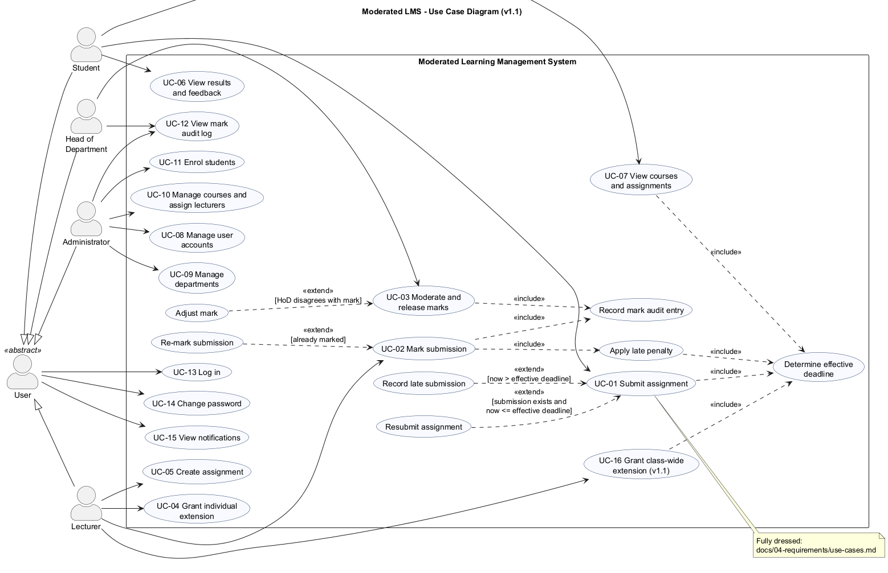

# Use Case Model

## 1. Use case diagram

Source: [`docs/diagrams/use-case.puml`](../diagrams/use-case.puml)

**Notation used**
- **Generalisation (actors):** the abstract actor *User* holds the use cases every role shares (log in, change password, view notifications); Student, Lecturer, Head of Department and Administrator specialise it.
- **«include»:** mandatory sub-behaviour factored out because it is reused, e.g. *Determine effective deadline* (by UC-01 Submit, UC-07 View assignments and *Apply late penalty*), and *Record mark audit entry* (by UC-02 and UC-03).
- **«extend»:** optional behaviour inserted at an extension point under a condition, e.g. *Resubmit assignment* extends UC-01 when a submission exists and the deadline has not passed; *Record late submission* extends UC-01 when the deadline has passed; *Adjust mark* extends UC-03 when the HoD disagrees.

## 2. Use case catalogue

| ID | Use case | Primary actor | Requirements |
|----|----------|---------------|--------------|
| UC-01 | Submit assignment | Student | FR-10, FR-11, FR-12 |
| UC-02 | Mark submission | Lecturer | FR-14, FR-15 |
| UC-03 | Moderate and release marks | Head of Department | FR-16, FR-17, FR-15 |
| UC-04 | Grant individual extension | Lecturer | FR-08 |
| UC-05 | Create assignment | Lecturer | FR-07 |
| UC-06 | View results and feedback | Student | FR-13 |
| UC-07 | View courses and assignments | Student | FR-09 |
| UC-08 | Manage user accounts | Administrator | FR-03, FR-21 |
| UC-09 | Manage departments | Administrator | FR-04 |
| UC-10 | Manage courses and assign lecturers | Administrator | FR-05 |
| UC-11 | Enrol students | Administrator | FR-06 |
| UC-12 | View mark audit log | HoD, Administrator | FR-18 |
| UC-13 | Log in | User | FR-01, FR-02 |
| UC-14 | Change password | User | FR-20 |
| UC-15 | View notifications | User | FR-19 |
| UC-16 | Grant class-wide extension *(v1.1)* | Lecturer | FR-22 |

---

## 3. Fully dressed use case specifications

### UC-01 Submit assignment

| Field | Content |
|-------|---------|
| **Primary actor** | Student |
| **Stakeholders and interests** | Student: submit work and correct mistakes before the deadline; late work not rejected. Lecturer: receives work, knows if it is late. HoD: penalties applied consistently. |
| **Trigger** | The student chooses "Submit or resubmit work" in the student menu. |
| **Preconditions** | P1 The student is logged in (UC-13). P2 The student is enrolled on the course of the assignment. P3 The assignment exists. |
| **Postconditions (success)** | S1 The submission is stored with status SUBMITTED (on time) or LATE, the submission time and a version number. S2 The content of this version is stored in the version history. S3 The course lecturer(s) receive a notification. |
| **Postconditions (failure)** | F1 No stored data is changed; any earlier submission is kept unchanged. |

**Main success scenario (on-time first submission)**
1. The system lists the student's assignments with their effective deadlines and status (includes *Determine effective deadline*).
2. The student enters the assignment ID.
3. The student types the answer (ending with a line containing ".") or types `@` and a file path.
4. The system checks that the student is enrolled and the work is not empty and not larger than 100 000 characters.
5. The system determines the student's effective deadline (the latest of the assignment deadline, the class-wide extension and the student's individual extension).
6. The system finds no earlier submission and the current time is not after the effective deadline.
7. The system stores the submission as SUBMITTED, version 1, and its content in the version history, in one transaction.
8. The system notifies the lecturers of the course.
9. The system confirms "Submitted on time" and states until when the student may resubmit.

**Alternative flows**
- **A1 Resubmission before the deadline (extends at step 6):** 6a. An unmarked submission exists and the current time is not after the effective deadline. 6b. The system replaces the content, sets the submission time to now, increments the version and stores the new version in the history (status SUBMITTED). 6c. The lecturers are notified of a resubmission. 6d. The system confirms "Resubmitted (version n)". Resume at step 9 (end).
- **A2 Late first submission (extends at step 6):** 6a. No earlier submission exists and the current time is after the effective deadline. 6b. The system stores the submission as LATE, version 1. 6c. The lecturers are notified that the work is late. 6d. The system confirms "Submitted LATE", shows the deadline and the late-penalty rule, and states that the work will still be marked with feedback.
- **A3 Submission from a file:** 3a. The student enters `@path`. 3b. The system checks that the path is a regular file, is not the LMS database and is at most 100 KB, then reads it as the content. Continue at step 4.
- **A4 Extension granted after a late submission:** handled by UC-04 - the LATE submission is reclassified as SUBMITTED if the new deadline covers it; the student may then resubmit until the new deadline.

**Exception flows**
- **E1 Deadline passed and a submission already exists (step 6):** the system shows "The deadline has passed. Resubmission is only allowed before the deadline; your previous submission has been kept." No data changes.
- **E2 Work already marked (step 6):** the system shows "This work has already been marked and cannot be resubmitted."
- **E3 Not enrolled (step 4):** the system shows "You are not enrolled on the course of this assignment."
- **E4 Unknown assignment ID (step 2/4):** the system shows "Assignment n does not exist."
- **E5 Empty or oversized work (step 4), unreadable/oversized file (step 3b):** the system shows the validation message; the student may try again.
- **E6 Database error at step 7:** the transaction is rolled back, the error is shown and the session continues.
- **E7 Input closed (e.g. terminal closed):** the program exits cleanly without a partial submission.

**Business rules:** BR-03 (effective deadline), BR-04 (late work never rejected), BR-05 (resubmission only before the deadline and before marking; all versions kept), BR-02 (lateness measured later, at marking time).
**Non-functional:** NFR-02 (response <= 1 s), NFR-08 (errors never crash the program).
**Frequency:** up to 800 students x several assignments per term.
**Tests:** SubmissionTest.* (integration), ST01-ST07, ST25-ST27 (system).

---

### UC-02 Mark submission

| Field | Content |
|-------|---------|
| **Primary actor** | Lecturer |
| **Stakeholders and interests** | Lecturer: record a mark quickly. Student: fair penalty, written feedback. HoD: every mark reaches moderation; changes are traceable. |
| **Trigger** | The lecturer chooses "Mark or re-mark a submission". |
| **Preconditions** | P1 The lecturer is logged in. P2 The lecturer teaches the course of the submission. P3 The submission is SUBMITTED, LATE or MARKED (not yet moderated). |
| **Postconditions (success)** | S1 The submission is MARKED with raw mark, days late, late deduction, final mark, feedback, marker and time. S2 Exactly one audit entry (MARK or REMARK) records who, when, old final mark, new final mark and reason, in the same transaction. S3 The HoD of the department is notified. S4 The mark remains hidden from the student. |

**Main success scenario**
1. The lecturer opens the submissions list of an assignment (ID, student, submission time, on time / days late, version, status, mark) and optionally reads a submission.
2. The lecturer enters the submission ID, a raw mark and multi-line written feedback, leaving the reason blank.
3. The system checks the lecturer teaches the course, the status is markable, 0 <= raw <= maximum and feedback is not empty.
4. The system computes the days late from the submission time and the student's effective deadline *at marking time* (includes *Determine effective deadline*).
5. The system applies the late-penalty policy (includes *Apply late penalty*): 10 % of the maximum per day for days 1-3, 0 after 3 days, never below 0.
6. The system stores the mark and writes the audit entry in one transaction (includes *Record mark audit entry*).
7. The system notifies the HoD and shows "Marked. Raw r, final f (explanation)" and that the mark is hidden until release.

**Alternative flows**
- **A1 Re-mark (extends at step 3, status MARKED):** 2a. The lecturer also enters a reason. 6a. The audit action is REMARK with the previous final mark as old value.
- **A2 Late work more than 3 days late:** 5a. Final mark is 0; the raw mark and feedback are still stored and later shown to the student.

**Exception flows**
- **E1 Mark out of range / not a number:** the UI re-prompts; the service rejects NaN or values outside 0..max with "Mark must be between 0 and max".
- **E2 Empty feedback:** "Written feedback must not be empty." Nothing is saved.
- **E3 Re-mark without reason:** "A reason is required when changing an existing mark."
- **E4 Submission already moderated or released:** "This submission has been moderated by the Head of Department and can no longer be changed by the lecturer."
- **E5 Lecturer does not teach the course:** "You do not teach the course of this assignment."
- **E6 Unknown submission:** "Submission n does not exist."

**Business rules:** BR-01, BR-02, BR-03, BR-06, BR-09, BR-10, BR-11.
**Tests:** MarkingTest.*, IT_MRK.LateMarking (6 boundary cases), ST08-ST10.

---

### UC-03 Moderate and release marks

| Field | Content |
|-------|---------|
| **Primary actor** | Head of Department |
| **Stakeholders and interests** | Principal/HoD: no mark reaches students unchecked. Lecturer: marks released promptly. Student: fair, final marks with feedback. Regulator: auditable decisions. |
| **Trigger** | A notification that marks await moderation, or the HoD chooses "Marks awaiting moderation". |
| **Preconditions** | P1 The HoD is logged in. P2 At least one submission of a course in the HoD's department is MARKED. |
| **Postconditions (success)** | S1 Each moderated submission is MODERATED with moderator and time; adjusted marks have the new final mark. S2 On release, every MODERATED submission of the assignment is RELEASED and its student notified. S3 Each approval, adjustment and release has an audit entry. S4 MARKED (unmoderated) and unmarked submissions remain hidden. |

**Main success scenario**
1. The system lists MARKED submissions of the HoD's department: submission, course, assignment, student, raw mark, late deduction, final mark / maximum, marker.
2. The HoD selects a submission and approves it, optionally with a note.
3. The system checks department scope and the MARKED status, sets MODERATED and writes an audit entry (MODERATION_APPROVE) in one transaction.
4. Steps 2-3 are repeated until the HoD is satisfied.
5. The HoD lists "Moderated marks ready for release", enters the assignment ID and confirms.
6. The system sets every MODERATED submission of the assignment to RELEASED, writes a RELEASE audit entry for each (one transaction), notifies each student and reports how many were released and how many remain awaiting moderation or unmarked.

**Alternative flows**
- **A1 Adjust mark (extends at step 2):** the HoD enters a new final mark (0..max) and a mandatory reason; the system stores the new final mark, keeps the lecturer's raw mark and writes MODERATION_ADJUST with old and new values. A moderated mark may be adjusted again before release.
- **A2 Release cancelled (step 5):** the HoD answers "n"; nothing is released.
- **A3 Partial release:** some submissions are still MARKED; they are not released and the summary says so.

**Exception flows**
- **E1 Submission of another department:** "This submission belongs to another department." (BR-08)
- **E2 Approve a submission that is not MARKED:** "Only a marked submission that awaits moderation can be approved."
- **E3 Adjust without reason / out of range:** validation error; nothing changes.
- **E4 Adjust after release:** "Only marked or moderated (unreleased) submissions can be adjusted." (BR-06)
- **E5 Unknown assignment or submission:** not-found message.

**Business rules:** BR-06, BR-07, BR-08, BR-09.
**Tests:** ModerationTest.*, NotificationTest.StudentLearnsNothingBeforeRelease, ST11-ST15.

---

## 4. Brief descriptions of the remaining use cases

- **UC-04 Grant individual extension** - Lecturer selects assignment, student and a new deadline later than the original, plus a reason. Replaces an earlier extension for the same student. Rejected for non-enrolled students or if the student's mark is already moderated. Reclassifies an unmarked LATE submission it covers. The student is notified.
- **UC-05 Create assignment** - Lecturer selects one of their courses and enters title, description, deadline (future, "YYYY-MM-DD HH:MM") and maximum mark (1-1000).
- **UC-06 View results and feedback** - Student sees every submission with status; mark details and feedback appear only once released.
- **UC-07 View courses and assignments** - Student sees enrolled courses and assignments sorted by effective deadline, with time left, "(extended)" marker and status.
- **UC-08..UC-11 Administration** - create accounts (username rules, password policy, department required for staff, one HoD per department), activate/deactivate, reset password; create departments and courses; assign lecturers (same department); enrol students.
- **UC-12 View mark audit log** - HoD: per submission or whole department; Administrator: whole school.
- **UC-13 Log in** - generic error on failure; lockout after 5 failures for 15 minutes; notifications shown after login; the menu depends on the role.
- **UC-14 Change password**, **UC-15 View notifications** - available to every role.
- **UC-16 Grant class-wide extension (v1.1, CR1)** - Lecturer selects one of their assignments, a new deadline later than the original and a reason. The deadline applies to every enrolled student (an individual extension that is even later still wins). Granting again replaces it. Refused once any submission of the assignment is moderated. Unmarked LATE submissions covered by the new deadline become SUBMITTED; all enrolled students are notified. «include» *Determine effective deadline*.
