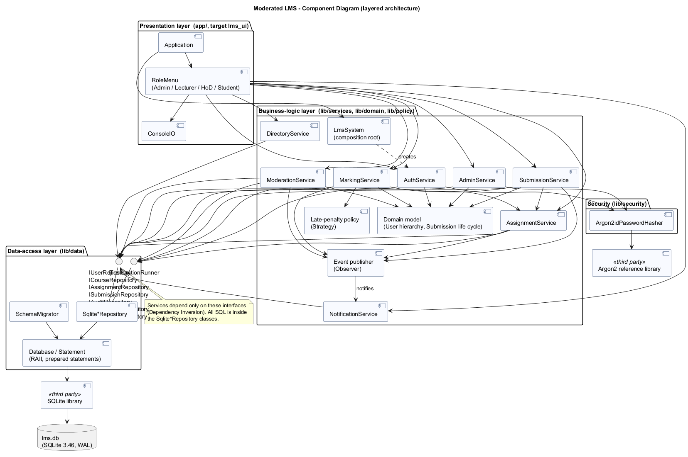
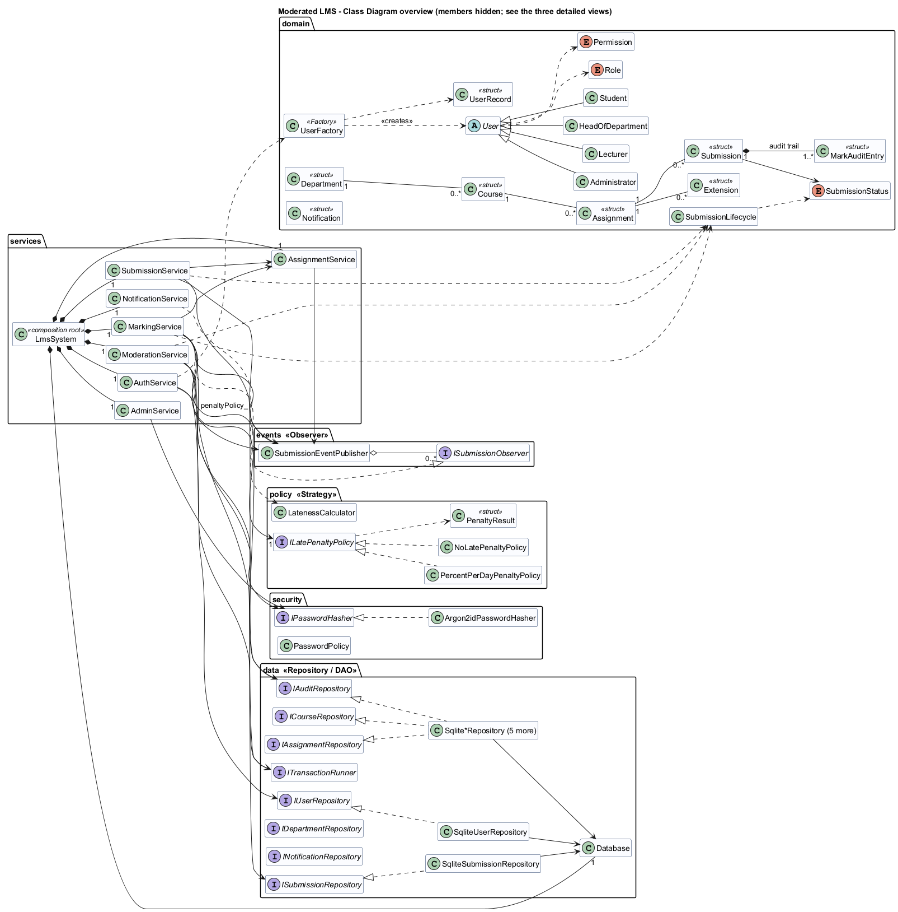
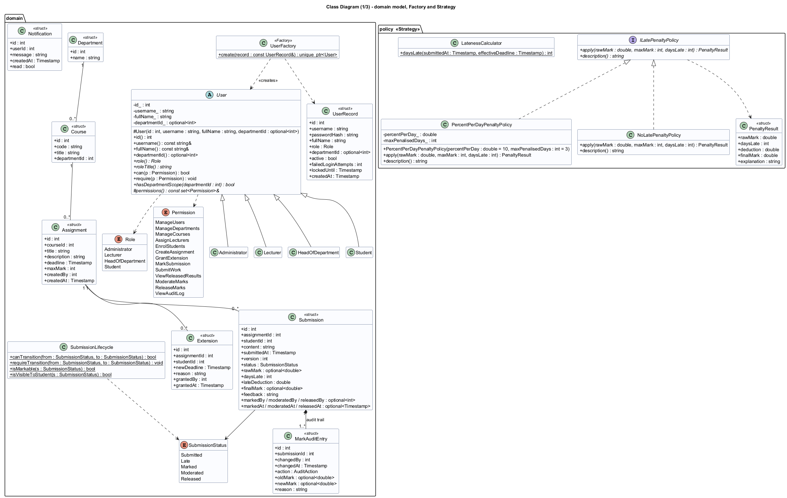
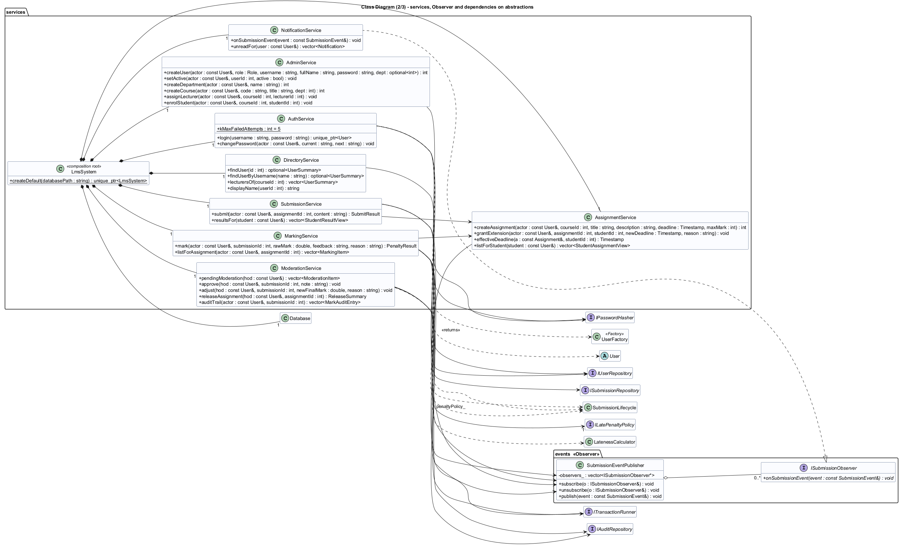
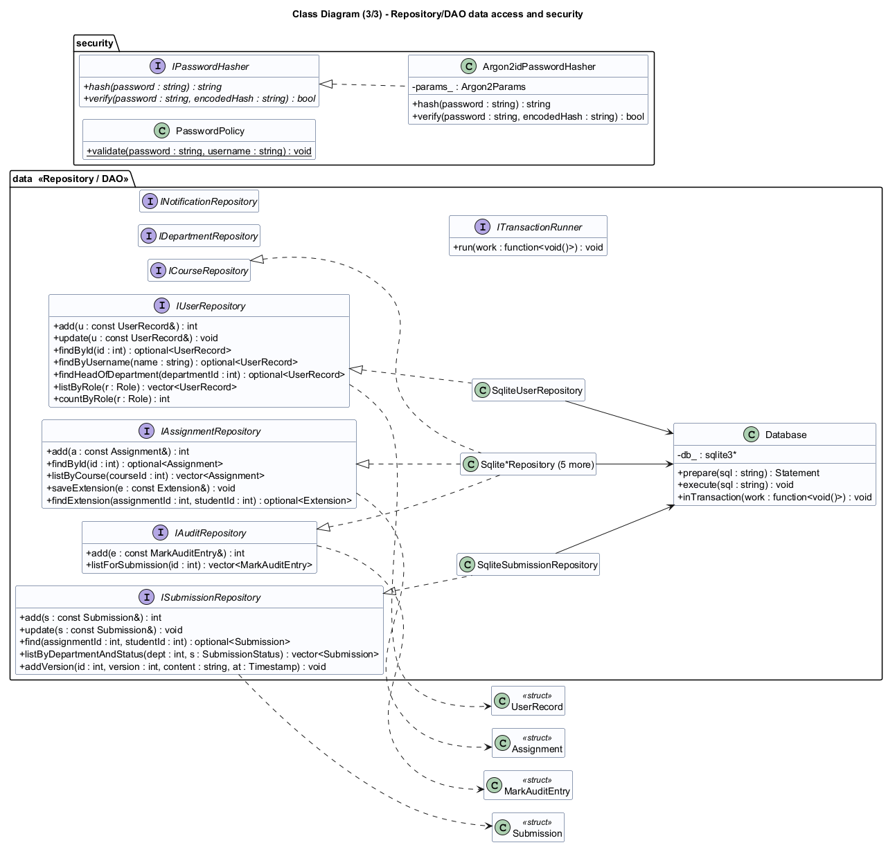
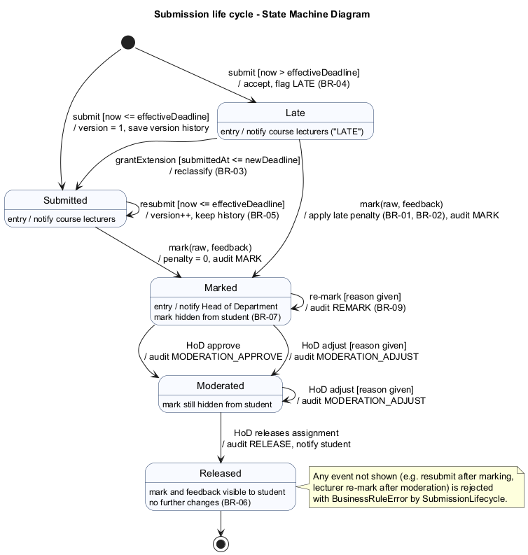
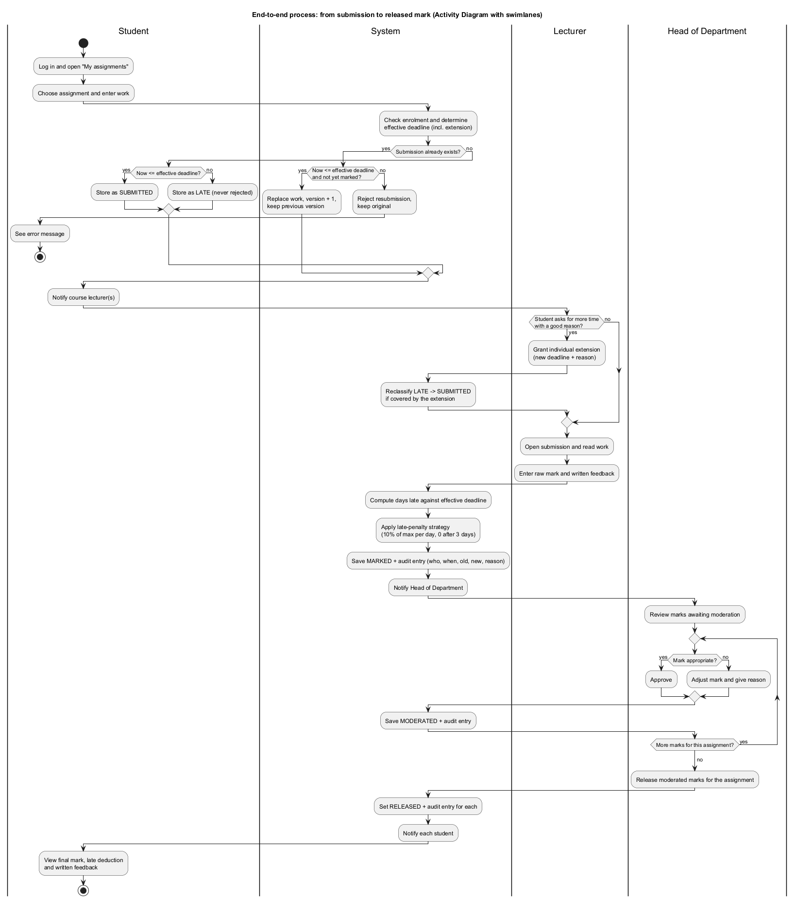
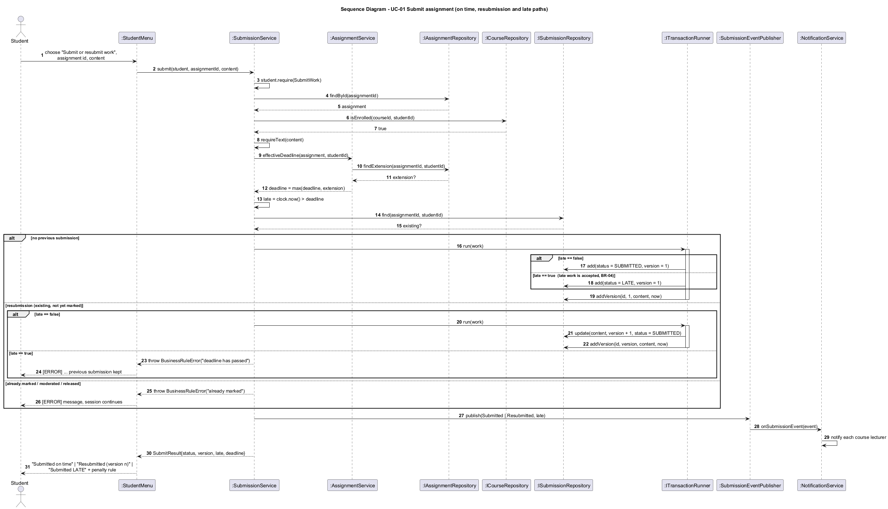
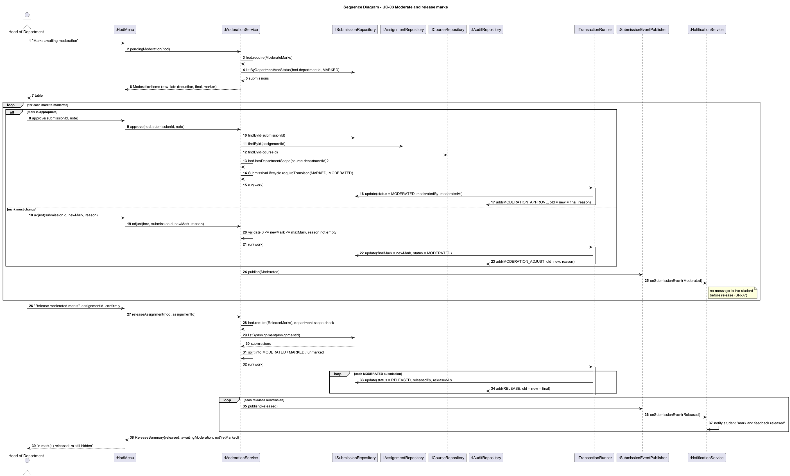
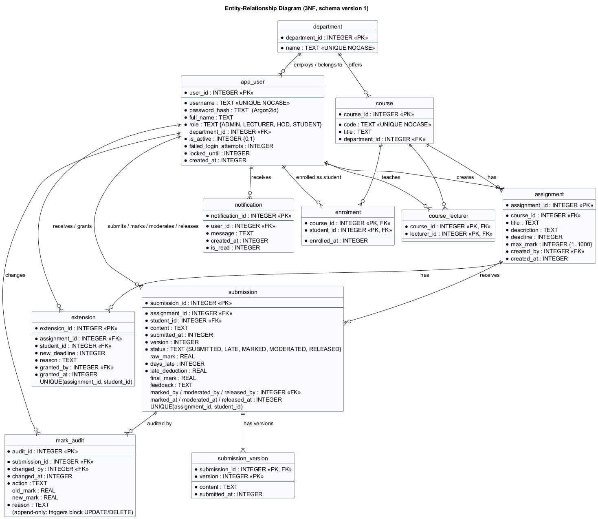

# Software Design Document (SDD)

**System:** Moderated LMS - design baseline approved at Gate 2 (release v1.0).
All diagrams are PlantUML sources in [`docs/diagrams`](../diagrams); rendered images are in `docs/diagrams/rendered`.

---

## 1. Architecture

### 1.1 Chosen style: strict layered architecture

| Layer | Folder / CMake target | Responsibility | May depend on |
|-------|----------------------|----------------|---------------|
| Presentation | `app/` -> `lms_ui`, `lms` | Console menus per role, input validation and re-prompting, formatting | Business-logic layer only |
| Business logic | `lib/services`, `lib/domain`, `lib/policy`, `lib/events`, `lib/security` -> `lms_core` | Use-case logic, access control, business rules, state machine, penalty strategy, notifications | Data-access **interfaces** |
| Data access | `lib/data` -> `lms_core` | Repositories, SQL, transactions, migrations | SQLite |
| Storage | `lms.db` | Persistent data | - |

Rules enforced in the code: the UI never includes a repository or SQL (three such calls written early in implementation were replaced by the read-only `DirectoryService`); services receive repositories only through the `Repositories` bundle of interfaces and `ITransactionRunner`; only `SqliteRepositories.cpp` and `Database.cpp` contain SQL.

### 1.2 Design rationale

**Why layered?**
1. The dominant quality attributes are *integrity* (moderation rules, audit), *testability* (penalty and deadline logic) and *maintainability* (a change request is expected). Layers put all rules in one place (`lms_core`) that is testable without a UI: 264 automated tests run against it in about one second.
2. The data layer is replaceable. Moving from SQLite to a client/server database for multi-computer use (risk R12) would only require new repository implementations.
3. The UI is replaceable. The brief allows "console or simple desktop GUI"; a GUI could call the same services.
4. It is simple enough for one developer and easy to explain at the viva.

**Alternatives considered and rejected**

| Alternative | Why rejected |
|-------------|--------------|
| **Model-View-Controller** | MVC is designed for UIs with several views that update from a changing model (GUIs, web). A console UI shows one screen at a time and does not observe the model, so MVC's view/model synchronisation brings no benefit, and "controllers" would duplicate the use-case services. Separating presentation from logic, the part of MVC that matters here, is achieved by the layers. |
| **Client-server (SQL server + thin clients)** | It would allow several computers to work at once, but it breaks the IT officer's constraints: it needs a network (NFR-09) and server administration on old hardware. Deferred to a future release. |
| **Single-module "big ball"** (menus calling SQL directly) | Fastest to write, but rules would be scattered across menu code, untestable without typing into the console, and any later change request would touch many places. |
| **Hexagonal (ports and adapters)** | Very close to what was built (the repository interfaces are ports). Naming the whole system hexagonal would add ceremony (driving ports for a single console adapter) without benefit at this size. |

### 1.3 Cross-cutting decisions
| Decision | Choice | Reason |
|----------|--------|--------|
| Time | `int64` seconds since epoch (UTC) everywhere; local time only for display/input | Deadline comparison is exact integer arithmetic, with no time-zone or DST ambiguity (risk R5) |
| Clock | `IClock` injected (`SystemClock` in production, `FixedClock` in tests) | Deterministic tests of lateness boundaries |
| Errors | Exception hierarchy rooted at `LmsError` (`ValidationError`, `AuthorizationError`, `BusinessRuleError`, `NotFoundError`, `DatabaseError`, ...) | The UI catches `LmsError` in one place (Template Method `RoleMenu::run`) so no failure ends the session (NFR-08) |
| Transactions | `ITransactionRunner` using nested SQLite SAVEPOINTs | Mark + audit are atomic (NFR-07); services can nest safely |
| Password hashing | Argon2id via the PHC reference library | See section 5 |
| Schema evolution | Numbered SQL migrations embedded at build time, `PRAGMA user_version` | One source of truth; a later release adds a new numbered file instead of editing 001 |

---

## 2. Detailed design - class diagrams

The design class diagram is shown as an overview plus three detailed views (a single diagram with every member is about 9 700 px wide and unreadable).

**Overview (relationships)**

**View 1 - domain model, Factory and Strategy**

**View 2 - services and Observer**

**View 3 - data access (Repository/DAO) and security**

### 2.1 Inheritance and polymorphism
`User` is abstract (pure virtual `role()`, `roleTitle()`, `hasDepartmentScope()`, `permissions()`). `Administrator`, `Lecturer`, `HeadOfDepartment` and `Student` are `final` subclasses. Role-specific behaviour is dispatched virtually:
- `can(Permission)` / `require(Permission)` use the subclass's permission set, which implements the access-control matrix (SRS 3.2).
- `hasDepartmentScope(dept)`: Administrator -> true for all departments, HoD -> only their own, others -> false. `ModerationService` and the audit functions call this instead of testing the role.
- The UI picks the menu class through `createMenuFor(user)`, and each menu class overrides `title()` and `items()`.

### 2.2 Design patterns

| Pattern | Where | Why it was chosen |
|---------|-------|-------------------|
| **Strategy** | `ILatePenaltyPolicy` <- `PercentPerDayPenaltyPolicy(10 %, 3 days)`, `NoLatePenaltyPolicy`; injected into `MarkingService` | The penalty rule was the most contested requirement (C2, C3) and the one most likely to change (a different rate, or waiving it for a course). With a strategy the rule can change without editing `MarkingService`, and it is unit-tested in isolation (`IT_MRK.PenaltyStrategyIsInjectable` swaps it). |
| **Repository / DAO** | `IUserRepository`, `ISubmissionRepository`, ... <- `Sqlite*Repository` | Isolates SQL (NFR-06 inspection is limited to one file), lets services be tested against an in-memory database, and makes a later move to a server database local to one layer. |
| **Factory Method** | `UserFactory::create(UserRecord)` | One place maps the stored role code to the concrete `User` subclass. `AuthService` returns `unique_ptr<User>` without knowing the subclasses; adding a role changes the factory only. |
| **Observer** | `SubmissionEventPublisher` / `ISubmissionObserver` <- `NotificationService` | Services announce life-cycle events (submitted, marked, released, extension) without depending on who reacts. Notifications were a *Could* requirement: removing or replacing them (e.g. SMS later) does not touch the services. |
| **Template Method** | `RoleMenu::run()` with abstract `title()` / `items()` | The session skeleton (greeting, notifications, menu loop, error handling) is written once, so every role gets identical robustness (NFR-08). |
| **Composition root / Dependency Injection** | `LmsSystem` | The only place that chooses concrete classes (SQLite, Argon2id, system clock, 10 % policy). Tests build the same graph with `FixedClock`, fast hash parameters or a different policy. |

### 2.3 SOLID

| Principle | How the design follows it | Example |
|-----------|---------------------------|---------|
| **S**ingle responsibility | Each service owns one group of use cases; persistence, hashing, lateness and presentation are separate classes. | `LatenessCalculator` only counts days; `PercentPerDayPenaltyPolicy` only turns days into a deduction; `MarkingService` only orchestrates marking. |
| **O**pen/closed | New behaviour is added by new classes, not by editing existing ones. | A new penalty rule is a new `ILatePenaltyPolicy`; a new notification channel is a new `ISubmissionObserver`; schema changes are new migration files. |
| **L**iskov substitution | Subclasses keep the base contracts: every `User` answers `can()` consistently, every policy returns a final mark within 0..raw. | `UT_PEN.PolicyIsSubstitutableThroughInterface`; `UT_USR.PermissionMatrix` tests all roles through `User&`. |
| **I**nterface segregation | Seven small repository interfaces instead of one "Database" interface; `IClock`, `IPasswordHasher`, `ITransactionRunner` each have one or two methods. | `AuthService` depends only on `IUserRepository`, `IPasswordHasher`, `IClock`. |
| **D**ependency inversion | Services depend on abstractions that the data layer implements; concrete classes are chosen only in `LmsSystem`. | `MarkingService(Repositories, ITransactionRunner&, const IClock&, ..., const ILatePenaltyPolicy&)`. |

Known compromise: services receive the whole `Repositories` bundle (7 interfaces) even when they use 3 or 4 of them. This keeps constructors short. The cost is a slightly wider dependency than ISP would ideally allow; it is documented here as a deliberate trade-off.

---

## 3. Behavioural models

### 3.1 State machine - Submission life cycle

The table of legal transitions is implemented once in `SubmissionLifecycle::canTransition` and tested exhaustively (all 25 from/to pairs, `UT_LIF.TransitionTable`). Guards map to business rules: resubmission only while `now <= effectiveDeadline` (BR-05); re-mark and adjust only with a reason (BR-09); `Released` is final (BR-06).

### 3.2 Activity diagram - from submission to released mark

Swimlanes: Student, System, Lecturer, Head of Department. Decision points show the resubmission and late branches, the optional extension, and the moderation loop with approve/adjust.

### 3.3 Sequence diagram - UC-01 Submit assignment (incl. late and resubmission paths)

### 3.4 Sequence diagram - UC-03 Moderate and release marks

---

## 4. Database design

### 4.1 Entity-relationship diagram (3NF)

The authoritative SQL schema is [`sql/001_initial_schema.sql`](../../sql/001_initial_schema.sql). CMake embeds these files into the program (`GeneratedMigrations.h`), so the documentation, the tests and the executable cannot drift apart.

### 4.2 Normalisation
- **1NF:** every column is atomic (no lists; lecturers of a course and enrolments are separate junction tables `course_lecturer`, `enrolment`; submission versions are rows in `submission_version`).
- **2NF:** the tables with composite keys (`course_lecturer`, `enrolment`, `submission_version`) have no attributes that depend on part of the key (`enrolled_at` depends on the whole (course, student) pair).
- **3NF:** no non-key attribute depends on another non-key attribute. The department of an assignment is reached via `course` and is not copied into `assignment`; the HoD of a department is derived from `app_user(role='HOD', department_id)` and is not stored in `department`, which would duplicate the fact and could contradict it. A partial unique index enforces one active HoD per department instead.

**Checked candidate for a transitive dependency - `submission.final_mark`.** At marking time `final_mark = max(0, raw_mark - late_deduction)`, which looks derivable. It is stored anyway because (a) after moderation the HoD may set a different value, so it becomes an independent fact, and (b) an assessment record must not change silently if the penalty policy changes later: the stored `days_late`, `late_deduction` and `final_mark` are the recorded decision, and the audit log refers to them. Both reasons keep it within 3NF: `final_mark` is not functionally determined by other attributes once moderation exists.

### 4.3 Data dictionary

| Table | Column | Type | Null | Constraint / meaning |
|-------|--------|------|------|----------------------|
| department | department_id | INTEGER | N | PK |
| | name | TEXT | N | UNIQUE (case-insensitive), 1-100 chars |
| app_user | user_id | INTEGER | N | PK |
| | username | TEXT | N | UNIQUE NOCASE, 3-32 chars `[A-Za-z0-9._-]` (checked in service) |
| | password_hash | TEXT | N | CHECK starts with `$argon2id$` (encoded hash incl. parameters and salt) |
| | full_name | TEXT | N | 1-100 chars |
| | role | TEXT | N | CHECK in (ADMIN, LECTURER, HOD, STUDENT) |
| | department_id | INTEGER | Y | FK department; CHECK required for HOD and LECTURER |
| | is_active | INTEGER | N | 0/1; inactive users cannot log in |
| | failed_login_attempts | INTEGER | N | >= 0; reset on success |
| | locked_until | INTEGER | N | epoch seconds; 0 = not locked |
| | created_at | INTEGER | N | epoch seconds |
| course | course_id | INTEGER | N | PK |
| | code | TEXT | N | UNIQUE NOCASE, 1-20 chars |
| | title | TEXT | N | 1-100 chars |
| | department_id | INTEGER | N | FK department (RESTRICT) |
| course_lecturer | course_id, lecturer_id | INTEGER | N | composite PK; FKs; service ensures same department (BR-11) |
| enrolment | course_id, student_id | INTEGER | N | composite PK; FKs |
| | enrolled_at | INTEGER | N | epoch seconds |
| assignment | assignment_id | INTEGER | N | PK |
| | course_id | INTEGER | N | FK course |
| | title | TEXT | N | 1-200 chars |
| | description | TEXT | N | default '' |
| | deadline | INTEGER | N | epoch seconds; in the future at creation (service) |
| | max_mark | INTEGER | N | CHECK 1..1000 |
| | created_by, created_at | INTEGER | N | FK app_user; epoch |
| extension | extension_id | INTEGER | N | PK |
| | assignment_id, student_id | INTEGER | N | FKs; UNIQUE pair (one extension per student per assignment) |
| | new_deadline | INTEGER | N | > assignment.deadline (service) |
| | reason | TEXT | N | non-empty (BR-09) |
| | granted_by, granted_at | INTEGER | N | FK app_user; epoch |
| submission | submission_id | INTEGER | N | PK |
| | assignment_id, student_id | INTEGER | N | FKs; UNIQUE pair (current submission) |
| | content | TEXT | N | current version's work |
| | submitted_at | INTEGER | N | time of current version |
| | version | INTEGER | N | >= 1 |
| | status | TEXT | N | CHECK in (SUBMITTED, LATE, MARKED, MODERATED, RELEASED) |
| | raw_mark | REAL | Y | >= 0; required once MARKED (table CHECK) |
| | days_late | INTEGER | N | >= 0, computed at marking |
| | late_deduction | REAL | N | >= 0 |
| | final_mark | REAL | Y | >= 0; required once MARKED |
| | feedback | TEXT | Y | mandatory at marking (service, BR-10) |
| | marked_by/at, moderated_by/at, released_by/at | INTEGER | Y | FK app_user / epoch |
| submission_version | submission_id, version | INTEGER | N | composite PK; FK CASCADE |
| | content, submitted_at | TEXT, INTEGER | N | history of every (re)submission |
| mark_audit | audit_id | INTEGER | N | PK |
| | submission_id, changed_by | INTEGER | N | FKs |
| | changed_at | INTEGER | N | epoch |
| | action | TEXT | N | CHECK in (MARK, REMARK, MODERATION_APPROVE, MODERATION_ADJUST, RELEASE) |
| | old_mark, new_mark | REAL | Y | final mark before / after |
| | reason | TEXT | N | non-empty; triggers forbid UPDATE and DELETE |
| notification | notification_id | INTEGER | N | PK |
| | user_id | INTEGER | N | FK CASCADE |
| | message, created_at, is_read | TEXT, INTEGER, INTEGER | N | |

Indexes: `ix_enrolment_student`, `ix_assignment_course`, `ix_submission_student`, `ix_submission_status`, `ix_mark_audit_submission`, `ix_notification_user`, `ix_course_department`, `ix_course_lecturer_lecturer`, `ix_app_user_role`. These support the queries the NFR-01..03 measurements depend on.

### 4.4 Mapping classes to tables

| Class (C++) | Table(s) | Differences and justification |
|-------------|----------|-------------------------------|
| `User` hierarchy (4 subclasses) + `UserRecord` | `app_user` | **Single-table inheritance.** The subclasses add behaviour, not data, so one table with a `role` discriminator avoids four identical tables and joins at login. `UserRecord` is the persistence DTO; `password_hash`, `failed_login_attempts` and `locked_until` live only there, so they never reach the UI (`UserSummary`). |
| `Department`, `Course`, `Assignment` | `department`, `course`, `assignment` | 1:1 |
| (no class) | `course_lecturer`, `enrolment` | Many-to-many associations `Course -- Lecturer/Student` become junction tables; exposed as repository methods (`assignLecturer`, `enrol`, `isEnrolled`) rather than classes because they carry no behaviour. |
| `Extension` | `extension` | 1:1 |
| `Submission` | `submission` + `submission_version` | The class holds the *current* version; history is a separate table (1NF) used for disputes and exposed through `ISubmissionRepository::addVersion/countVersions`. |
| `SubmissionStatus` (enum) | `submission.status` TEXT + CHECK | Stored as readable codes rather than integers so the database remains understandable to an auditor. |
| `MarkAuditEntry`, `AuditAction` | `mark_audit` | 1:1; append-only is enforced in the database, not only in code. |
| `Notification` | `notification` | 1:1 |
| Services, policies, publisher | - | Behaviour only; no persistence. |

---

## 5. Security design

| Threat | Control | Where |
|--------|---------|-------|
| Stolen database reveals passwords | **Argon2id** (winner of the Password Hashing Competition, RFC 9106), m = 19 MiB, t = 2, p = 1, 16-byte salt from the OS CSPRNG (`BCryptGenRandom` / `/dev/urandom`); encoded string stores parameters, so they can be raised later | `Argon2idPasswordHasher` |
| Brute force at the console | 5-failure lockout for 15 min; generic message; admin reset | `AuthService` |
| Username enumeration by timing | Unknown user still performs one hash verification (review finding R1) | `AuthService` |
| SQL injection | Only prepared statements with bound parameters; no SQL in UI/services | `Statement::bind`, repositories |
| Tampering with marks | Role/department checks in every service call; state machine; append-only audit table with triggers | services, schema |
| Shoulder surfing | Password input without echo | `ConsoleIO::readPassword` |
| Exfiltration through file submission | `@file` refuses the database file and files > 100 KB | `StudentMenu` |

**Why Argon2id and the PHC reference library.** Bcrypt truncates passwords at 72 bytes and is not memory-hard. PBKDF2 (e.g. via OpenSSL) is not memory-hard, so GPU attacks are cheap, and pulling in OpenSSL for one function is heavy to build offline on Windows. scrypt is memory-hard but has no standardised encoded format in common C libraries. Argon2id is the OWASP-recommended first choice, and the PHC reference implementation is small, portable C (6 files, CC0/Apache-2.0) built from a pinned, hash-verified source. libsodium's `crypto_pwhash` would be equally acceptable; it was not chosen because its CMake/Windows build is heavier than needed.
