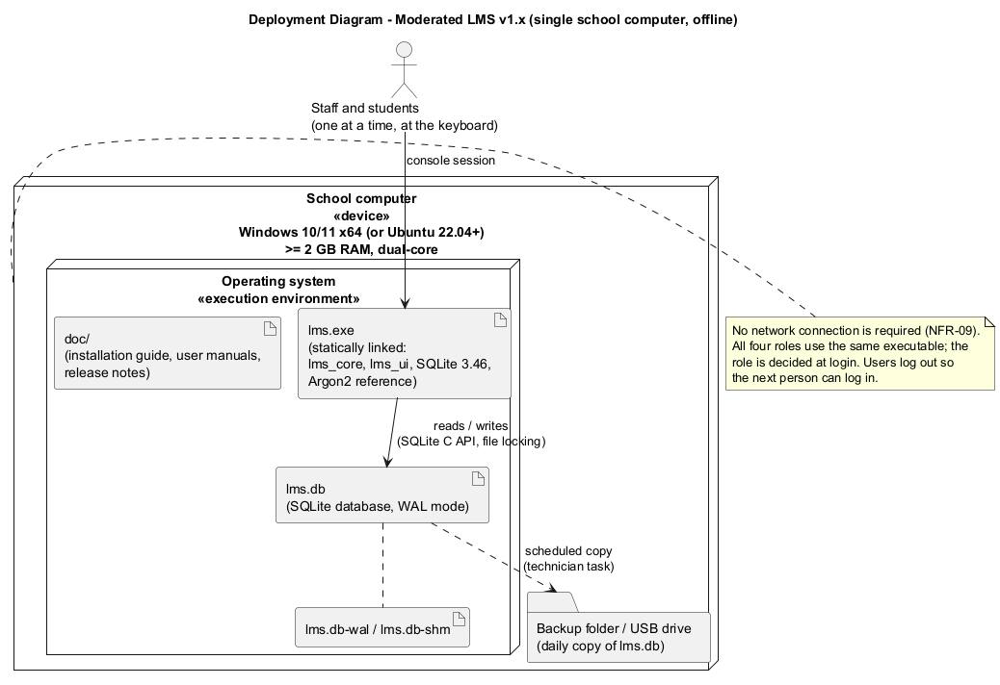

# Installation Guide (for the school technician)

This guide installs the Moderated LMS on **one** school computer. No internet connection is needed to install or use it.



## 1. What you need
- A computer with Windows 10 or 11 (64-bit), at least 2 GB RAM and 100 MB free disk space. (Ubuntu 22.04 or later also works; see section 7.)
- The release file `ModeratedLMS-1.x.x-Windows.zip` (from the GitHub release page or a USB stick).
- A USB drive or second folder for backups.
- About 20 minutes.

## 2. Install
1. Log in to Windows with an account that can create folders on drive C:.
2. Create the folder `C:\SchoolLMS`.
3. Copy the ZIP file into `C:\SchoolLMS` and extract it (right-click > *Extract All...* > *Extract*). You now have:
   ```
   C:\SchoolLMS\bin\lms.exe
   C:\SchoolLMS\doc\  (this guide, the user manuals and the release notes)
   ```
4. Create a data folder: `C:\SchoolLMS\data`.
5. Create a desktop shortcut:
   - Right-click the desktop > *New* > *Shortcut*.
   - Location: `C:\SchoolLMS\bin\lms.exe --db C:\SchoolLMS\data\lms.db`
   - Name: `School LMS`.
   - Right-click the new shortcut > *Properties* > *Start in*: `C:\SchoolLMS\data` > *OK*.
6. Protect the data folder so that only the technician's Windows account and the LMS can change it: right-click `C:\SchoolLMS\data` > *Properties* > *Security*, and remove "Users: Modify" if your school's policy allows. Students must not be able to copy `lms.db`.

## 3. First start (create the administrator)
1. Double-click **School LMS**. A black text window opens.
2. The program says *"First run: no administrator account exists."*
3. Type a username for the administrator (e.g. `admin`), the full name, and a password (at least 8 characters with letters and digits). The password is not shown while you type, which is normal.
4. Choose `1` to log in with the new account. You now see the **Administrator menu**.
5. Give the administrator account details to the person who will manage users (see the Administrator manual).

To check the version: open *Command Prompt* and run `C:\SchoolLMS\bin\lms.exe --version`.

### Optional: demonstration data for training
To practise before real use, start the program with a **separate** database:
`C:\SchoolLMS\bin\lms.exe --db C:\SchoolLMS\data\training.db --seed-demo`
Every demo account (`admin`, `hod.sci`, `lect.sci`, `stud1`...`stud5`, ...) uses the password `Passw0rd2026`. Never use `--seed-demo` on the real database.

## 4. Daily backup (important)
All school data is in one file, `C:\SchoolLMS\data\lms.db`.
1. At the end of each day, make sure nobody is using the LMS (the window is closed).
2. Copy `lms.db` (and `lms.db-wal` if it exists) to the backup drive into a folder named with the date, e.g. `E:\LMS-backup\2026-10-15\`.
3. Keep at least the last 10 daily copies and one copy per month.

Automatic option: Windows *Task Scheduler* > *Create Basic Task* > daily at 17:30 > *Start a program* `robocopy` with arguments
`C:\SchoolLMS\data E:\LMS-backup\latest lms.db lms.db-wal`.

**Restore:** close the LMS, copy the backup `lms.db` back into `C:\SchoolLMS\data`, delete any `lms.db-wal` and `lms.db-shm` there, start the LMS.

## 5. Upgrading to a new version (e.g. 1.0 -> 1.1)
1. Make a backup (section 4).
2. Extract the new ZIP over `C:\SchoolLMS` (replace files when asked). The `data` folder is not touched.
3. Start the LMS. The database is upgraded automatically the first time; the program refuses to open a database created by a *newer* version, so you cannot accidentally downgrade.

## 6. Things you must not do
- **Do not** put `lms.db` on a network share or open it from two computers at once. The system is designed for one computer; SQLite files can be damaged over network shares.
- Do not edit `lms.db` with other tools. The audit table refuses changes, and editing other data bypasses the school's rules.
- Do not change the computer's date and time. Deadlines and late penalties depend on the correct time.

## 7. Linux (Ubuntu) installation
```sh
sudo apt install build-essential cmake git
git clone <repository-url> lms && cd lms
cmake -S . -B build -DCMAKE_BUILD_TYPE=Release -DLMS_BUILD_TESTS=OFF
cmake --build build
sudo install -m 755 build/app/lms /usr/local/bin/lms
mkdir -p ~/lms-data && lms --db ~/lms-data/lms.db
```

## 8. Troubleshooting

| Message / problem | Cause | What to do |
|-------------------|-------|------------|
| `Fatal error: Cannot open database ...` | Folder does not exist or no permission | Create `C:\SchoolLMS\data`; check the shortcut's `--db` path and folder permissions |
| `The database was created by a newer version of the LMS` | An old `lms.exe` was started on an upgraded database | Install the newer version |
| `This account is temporarily locked` | 5 wrong passwords | Wait 15 minutes, or the administrator uses *Reset a user's password* |
| Window closes immediately | Started without the shortcut, or the database path is wrong | Run from Command Prompt to see the message |
| Deadlines look wrong by hours | Wrong time zone or clock on the PC | Correct Windows date/time settings |
