<div class="title-page" markdown="1">

# Moderated Learning Management System

## CS4433 Software Engineering - Final Project Report

**National University of Lesotho**

Department of Mathematics and Computer Science

**Student:** [Full name]

**Student number:** [Student number]

**Supervisor:** [Supervisor name]

**Repository:** [GitHub repository URL] (tags `v1.0`, `v1.1`)

**Date:** November 2026

</div>

## Abstract

This report describes how a moderated Learning Management System (LMS) for a secondary school was taken through the full software engineering life cycle using the Waterfall model with V-Model verification and validation. The school needs students to submit assignments, lecturers to mark them, and Heads of Department to moderate every mark before students can see it, with late penalties, individual extensions, resubmission and a complete record of every mark change. Seven conflicts and twelve ambiguities in the stakeholder statements were resolved into a specification of 21 functional requirements, 12 measurable non-functional requirements and 12 business rules. The system was designed as a strict layered architecture using Strategy, Repository, Factory Method, Observer and Template Method patterns, and implemented in C++17 with SQLite and Argon2id password hashing. Verification used 264 automated unit, integration and system tests derived by equivalence partitioning and boundary-value analysis, performance tests with 800 students, and scripted acceptance tests. Line coverage of the business-logic layer was 95.9 % and eight defects were found and closed. After release v1.0 a change request for class-wide extensions was analysed as perfective maintenance, implemented as release v1.1 and regression-tested (278 tests). The report closes with the professional, legal and ethical issues raised by processing learners' data and a critical reflection on the process.

<div class="toc-placeholder"></div>

## 2. Introduction

### 2.1 Context and problem
Assessment in the school is still largely paper-based. Lecturers collect work, calculate late penalties by hand and pass marks to Heads of Department (HoDs), who check them before they are published. The process is slow, penalties are applied inconsistently, and when a mark is questioned there is no reliable record of who changed it, when or why. The school asked for a Learning Management System that manages courses, assignments and assessment for four types of user (students, lecturers, HoDs and an administrator), where every user can only perform the actions of their role, every submission follows a defined life cycle, and every change to a mark is recorded.

The constraints are demanding for their simplicity. The system must run offline on the school's old computers, must be usable by teachers who "are not IT experts", must protect passwords, and must respond quickly with all 800 students stored. Web and mobile interfaces, online payment, plagiarism detection and automated grading are out of scope. The system is a C++ console application with a SQLite database.

### 2.2 Aims
The project aimed to (1) plan and manage a realistic software project; (2) elicit, reconcile and specify verifiable requirements from conflicting stakeholders; (3) produce a justified design with UML, design patterns and a normalised database; (4) implement a maintainable and secure object-oriented application; (5) verify and validate it systematically; (6) apply configuration management and quality assurance; and (7) manage a change after release while considering the professional, legal and ethical implications.

### 2.3 Approach
The brief prescribes the **Waterfall model** (Royce, 1970) with three phase gates, and the **V-Model** (Forsberg and Mooz, 1991) for verification: each development phase on the left of the "V" has a matching test level on the right that verifies it. Waterfall suits this project because the requirements are relatively stable once the stakeholder conflicts are resolved, the product is small, and the brief requires documented deliverables at each phase. Its weakness, late discovery of misunderstood requirements, was reduced by resolving conflicts explicitly at Gate 1 and by deriving system tests directly from the use cases. Every artefact described here is in the Git repository, and a traceability matrix (Appendix A) links each requirement to its use case, design elements, source files and tests.

### 2.4 Structure of the report
Section 3 presents the project management plan. Section 4 covers requirements engineering, section 5 the design, section 6 the implementation and section 7 verification and validation. Section 8 describes configuration management and quality assurance, section 9 deployment, section 10 the maintenance change request and section 11 professional issues. Section 12 concludes with a critical reflection.

## 3. Project Management Plan

### 3.1 Feasibility
A feasibility study was carried out before committing to the project, covering five dimensions (full study: `docs/03-project-management/project-management-plan.md`).

*Technical feasibility* was high. SQLite gives transactional, single-file storage with no server, which fits the offline constraint, and the C++ standard library covers everything else except password hashing, for which a small reference library exists. A console application with an embedded database needs very little memory; measured login time on the development PC was between 56 and 153 ms. The main technical risk identified was the toolchain itself, and it did occur (section 3.4).

*Operational feasibility* depends on non-expert users. Numbered text menus, one task per option, role-specific manuals and a demonstration database for training address this. A single shared computer could become a queue near deadlines; this is mitigated by the speed of submission and recorded as a limitation.

*Economic feasibility* is favourable. All tools and libraries are free and open source, existing hardware is reused, and the only cash cost is about LSL 300 for backup media. Developer time and training are in-kind. Hosted commercial LMS products would add subscription costs and would fail the offline requirement.

*Legal feasibility* was assessed against the Lesotho Data Protection Act 2011, which governs the processing of learners' personal information. The design minimises the data held, keeps it on the school's own computer and restricts access by role (section 11). Third-party licences (public domain, CC0/Apache-2.0, BSD-3) allow the intended use.

*Schedule feasibility* was tight: 36 days of effort in 35 working days, possible only because some tasks run in parallel off the critical path. A MoSCoW scope rule (drop "Could" requirements first) was adopted as the contingency.

The recommendation was to proceed with a single-computer, offline architecture, set up the toolchain and continuous integration early, and treat notifications (a Could requirement) as optional scope.

### 3.2 Work breakdown and schedule
The Work Breakdown Structure (Figure 1) decomposes the project into nine work packages that mirror the phases of the brief, each ending in a deliverable. The Gantt chart (Figure 2) schedules them over seven weeks from 21 September 2026, with finish-to-start dependencies, three phase gates and four milestones.

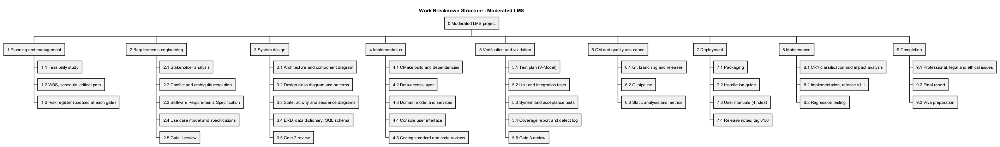

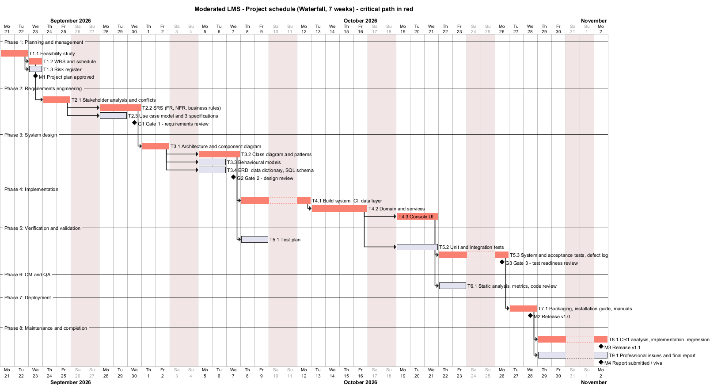

The **critical path** runs through feasibility, WBS, stakeholder analysis, SRS, architecture, class design, the three implementation packages, system testing, deployment and the change request. Tasks off the critical path (the risk register, use-case specifications, behavioural models, database design, test planning, unit testing, quality assurance and report writing) have float and were the planned buffer. The critical path runs through implementation of the business logic before the user interface, so the most uncertain code was written first. It also runs through system testing rather than unit testing: unit tests are written alongside the code and do not by themselves release anything.

### 3.3 Monitoring and control
Progress was checked weekly against the Gantt chart. Each gate had written exit criteria: at Gate 1, a signed-off SRS with at least 12 functional and 6 measurable non-functional requirements; at Gate 2, a design consistent with the SRS, with no implementation beforehand; at Gate 3, all Must requirements tested, coverage of at least 70 % and no open major defects. Quality gates were automated where possible: the CI pipeline fails on compiler warnings on Linux, on any failing test, on coverage below 70 % and on any cppcheck finding.

A candid note on plan versus actual: the gate dates are the plan. The implementation, tests and documents were in fact produced in a concentrated effort, and the Git history is the authoritative record of when each artefact was created. The documents do not claim otherwise.

### 3.4 Risk management
The risk register (Appendix D) started with eleven risks across technical, project and people categories. Each has likelihood and impact on a 1-5 scale, exposure (L x I), a mitigation, a contingency and an owner. It was re-scored at every gate. The highest initial exposures were schedule overrun (R2, 20) and errors in deadline and penalty logic (R5, 15), the latter because an error would directly produce unfair marks.

The register earned its place during the project. **R1**, an unusable toolchain, *occurred*: the development PC had no C++ compiler or CMake, and installing Visual Studio was not possible. The contingency was to use portable toolchains (Clang 21 via the Zig distribution, later MinGW-w64 GCC 16, and CMake and Ninja from Python packages), which cost roughly half a day rather than derailing the schedule. **R8**, unreliable internet, also occurred: dependency downloads broke repeatedly. The mitigation (pinning every dependency by version and SHA-256, and building from a local cache through CMake's `FETCHCONTENT_SOURCE_DIR_*` variables) made the build reproducible as well as robust. Building with a second compiler because of R1 had an unplanned benefit: GCC's stricter warnings found a defect (DEF-03) that Clang missed and that would otherwise have broken the Linux CI build. New risks were added as they emerged, for example R12 (the school placing the database on a network share, which can corrupt SQLite files) and R13 (CI not yet run on GitHub).

## 4. Requirements Engineering

### 4.1 Stakeholders
Nine stakeholders were identified and analysed by influence and interest (Appendix; `stakeholder-analysis.md`). The principal (sponsor), HoDs and lecturers have high influence or interest and were "managed closely". The student representative speaks for the largest user group but has low formal influence, which creates an ethical duty to make sure students' interests are not overridden simply because they carry less power. The IT officer owns the non-functional constraints. Parents and the examinations regulator are indirect stakeholders with interests in privacy and in the integrity of assessment records.

### 4.2 Conflicts and their resolution
The stakeholder statements contain seven conflicts. The four most significant, and the reasoning behind each resolution, are summarised here.

**C1: when students see marks.** The principal requires that students see no mark until the HoD has checked it; a lecturer wants students to see marks as soon as they are marked. The principal's rule was adopted because the principal is the sponsor, the HoD independently asks for the same control, and moderation protects both fairness and the school's reputation. Simply ruling against the lecturer would miss the *need* behind the statement, which is speed. The design therefore attacks the delay rather than the control: the HoD is notified the moment a mark awaits moderation, the moderation queue loads in well under two seconds even with 800 scripts, a whole assignment is released in one action, and the lecturer can see that a mark is "awaiting moderation".

**C2: late work.** The HoD wants late work penalised by 10 % of the available mark per day for three days and zero after that; the student representative insists that late work "should not simply be rejected". These statements conflict only if a zero is treated as a rejection. The resolution separates *acceptance* from *scoring*: late work is always accepted, stored and marked with written feedback, and the penalty affects only the final mark. A learner who submits five days late still receives feedback and a record that the work was done.

**C3: extensions against penalties.** Lecturers want to give extensions for good reasons, while the HoD wants penalties applied consistently. An extension therefore moves the deadline that the penalty is measured from, requires a written reason, and cannot be granted once the mark has been moderated, so it cannot be used to undo a moderation decision.

**C6: security against speed on old hardware.** Memory-hard password hashing is slow by design, yet the IT officer requires quick responses on old computers. Argon2id is used at the OWASP minimum parameters (19 MiB, two iterations) rather than the library's heavier defaults. The algorithm stays memory-hard while login stays around 0.1 s. Because the parameters are stored in each hash, they can be raised later without resetting anyone's password.

Twelve ambiguities were also resolved and confirmed at Gate 1. The most consequential concerned the meaning of "a day late". It was defined as **each started 24-hour period** after the student's effective deadline: one second late is one day, exactly 24 hours is one day, and 24 hours and one second is two days. The alternatives, calendar days and rounding to the nearest day, were rejected. Calendar days make the penalty depend on the time of day of the deadline, and rounding gives up to twelve hours of lateness for free. "10 % of the available mark" was interpreted as 10 % of the *maximum* mark, so the deduction is the same for every student at the same lateness. The deduction is capped so that a mark never becomes negative.

### 4.3 Software Requirements Specification
The SRS follows the structure of ISO/IEC/IEEE 29148:2018: introduction, overall description (user classes, environment, constraints, assumptions), specific requirements, and verification. It contains **21 functional requirements** (FR-01 to FR-21; FR-22 was added by CR1), **12 non-functional requirements** and **12 business rules**, each uniquely identified, MoSCoW-prioritised and tied to a verification method. Table 1 shows a representative subset.

| ID | Requirement (abridged) | Priority | Verified by |
|----|------------------------|----------|-------------|
| FR-02 | Each user can perform only the actions of their role (access matrix) | Must | 52-case permission test, ST17 |
| FR-11 | Resubmission up to the effective deadline while unmarked; all versions kept | Must | SubmissionTest, ST02, ST04 |
| FR-14 | Lecturer enters raw mark and mandatory feedback; system applies late penalty | Must | 29 penalty/lateness cases, ST08 |
| FR-15 | Every mark change audited: who, when, old, new, reason | Must | Audit trail tests |
| FR-17 | HoD releases moderated marks; unmoderated marks stay hidden | Must | ModerationTest, ST11, ST15 |
| NFR-01 | Login within 2 s with 800 students stored (production Argon2id) | Must | Performance test: 153 ms |
| NFR-04 | Passwords only as salted Argon2id, m >= 19 MiB, t >= 2, 16-byte salt | Must | Hasher tests, schema CHECK |
| NFR-06 | 100 % of SQL with user data uses bound parameters | Must | Inspection + injection tests |
| NFR-08 | No invalid input or DB error ends the program | Must | 10 exception-flow system tests |
| NFR-11 | Business-logic coverage >= 70 %; no function CCN > 15 | Should | gcovr 95.9 %, lizard max 14 |

*Table 1 - Extract from the SRS (full SRS: `docs/04-requirements/srs.md`).*

Every non-functional requirement was made measurable in the way the brief asks. "The system should respond quickly even with all 800 students on it" became three requirements with numbers, a data set and a reference build: NFR-01 to NFR-03. "Passwords must be protected" became two requirements (NFR-04 and NFR-05) naming the algorithm, its minimum parameters, the password rules, the lockout threshold and duration, and the requirement that a failed login does not reveal whether a username exists. Each can be checked by a test that either passes or fails.

### 4.4 Use case model
The use case diagram (Figure 3) covers the four actors. Generalisation from an abstract *User* actor carries the use cases shared by every role (log in, change password, view notifications), which avoids four identical sets of associations. «include» factors out mandatory reused behaviour: *Determine effective deadline* is needed to submit, to list assignments and to apply penalties, and *Record mark audit entry* is needed by both marking and moderation. «extend» models optional behaviour inserted at an extension point under a condition: resubmission and late submission extend *Submit assignment*, re-marking extends *Mark submission*, and adjusting a mark extends *Moderate and release marks*.

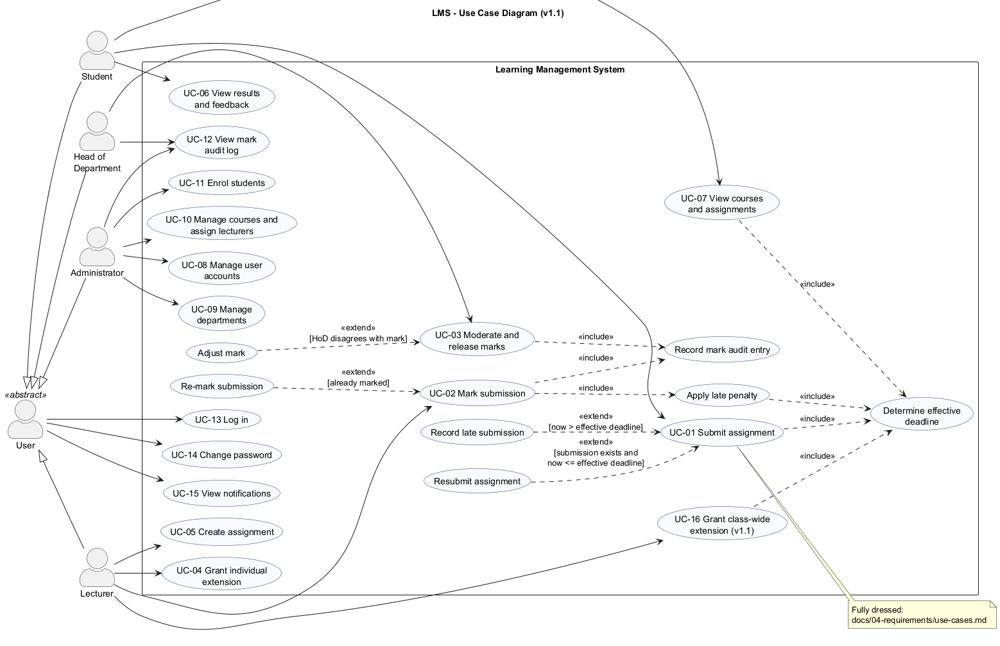

Three use cases were specified in fully dressed form: UC-01 *Submit assignment*, UC-02 *Mark submission* and UC-03 *Moderate and release marks*. UC-01 is reproduced below; the other two are in Appendix E. The alternative and exception flows proved to be the most valuable part of the specifications, because each became a system test (section 7).

| UC-01 Submit assignment | |
|---|---|
| Primary actor | Student |
| Preconditions | The student is logged in and enrolled on the course; the assignment exists |
| Success postconditions | Submission stored as SUBMITTED or LATE with time and version; version recorded in the history; course lecturers notified |
| Failure postcondition | No stored data changes |
| Main flow | 1. System lists the student's assignments with effective deadlines. 2. Student enters the assignment ID. 3. Student types the work, or `@path` to a file. 4. System checks enrolment and that the work is non-empty and at most 100 000 characters. 5. System determines the effective deadline. 6. No earlier submission exists and the deadline has not passed. 7. Submission stored as SUBMITTED, version 1, in one transaction. 8. Lecturers notified. 9. Student told until when resubmission is possible. |
| Alternative flows | A1 Resubmission before the deadline: work replaced, version incremented. A2 First submission after the deadline: stored as LATE, penalty rule shown. A3 File submission: regular file, at most 100 KB, never the LMS database. |
| Exception flows | E1 Resubmission after the deadline refused, original kept. E2 Already marked. E3 Not enrolled. E4 Unknown assignment. E5 Empty or oversized work. E6 Database error rolled back. E7 Input closed: clean exit. |
| Business rules | BR-03 (effective deadline), BR-04 (late work never rejected), BR-05 (resubmission window) |

*Table 2 - Fully dressed use case UC-01 (UC-02 and UC-03 in Appendix E).*

## 5. Software Design

### 5.1 Architecture
A **strict layered architecture** was chosen (Figure 4). The presentation layer (console menus) calls only the business-logic layer. The business-logic layer (domain model, services, policies, security) depends only on *interfaces* of the data-access layer. The data-access layer (repositories, prepared statements, migrations) is the only code that contains SQL. The layers are separate CMake targets (`lms_ui` and `lms_core`), so the dependency rules are enforced by the build as well as by convention.

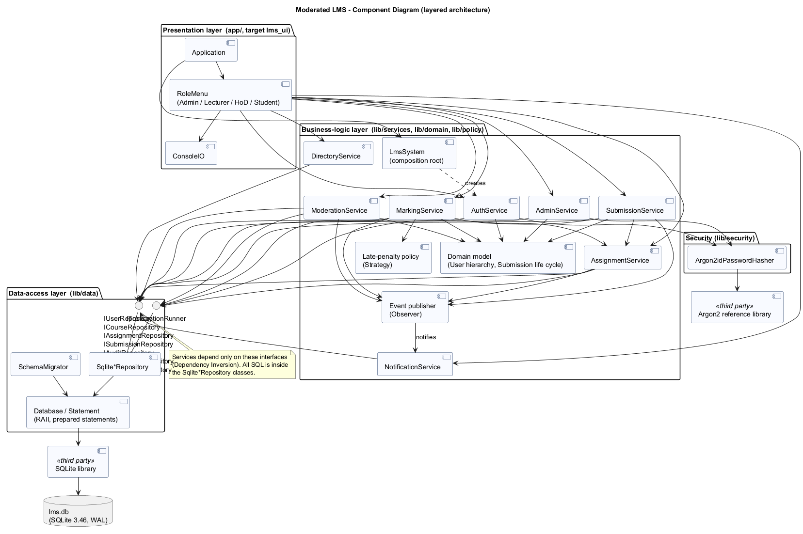

The choice follows from the quality attributes that dominate this system. *Integrity* (moderation, audit) and *testability* (deadline and penalty logic) require business rules to live in one place that can be exercised without typing into a console; 278 automated tests run against that layer in about a second. *Maintainability* matters because a change request was expected, and the layers localise change. The data layer can be replaced, which matters because the most likely future requirement, several computers at once, would need a database server. The console could also be replaced by the "simple desktop GUI" the brief allows without touching the rules.

Three alternatives were considered and rejected. **Model-View-Controller** is designed for interfaces with several views that must stay synchronised with a changing model, as in GUIs and web applications. A console shows one screen at a time and never observes the model, so MVC's machinery would add controllers that duplicate the use-case services without any benefit; the part of MVC that matters here, keeping presentation separate from logic, is delivered by the layers. A **client-server** architecture would support concurrent users but violates the offline and old-hardware constraints and adds server administration the school cannot provide; it is recorded as future work. A single-module design with menus calling SQL directly would have been quickest to write, but it scatters the rules across user-interface code and makes them untestable in isolation. The maintenance phase later confirmed the choice (section 10).

### 5.2 Class design, patterns and SOLID
The design class diagram is presented as an overview plus three detailed views (Figures 5 to 7), because a single diagram with every member was about 9 700 pixels wide and unreadable. The diagrams show visibility, types, multiplicities, inheritance, interfaces and pattern roles.

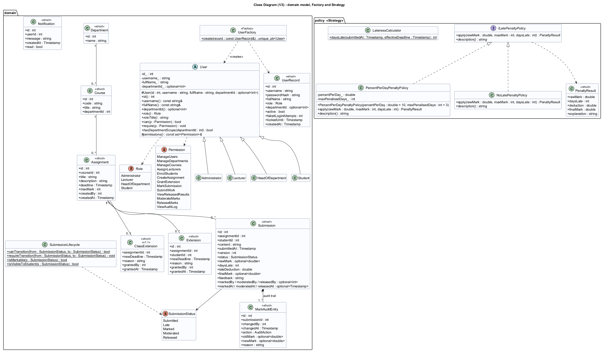

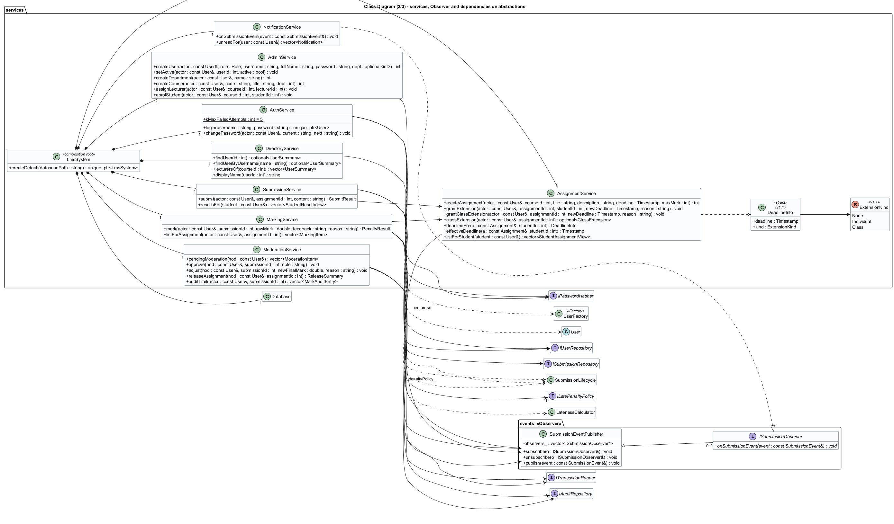

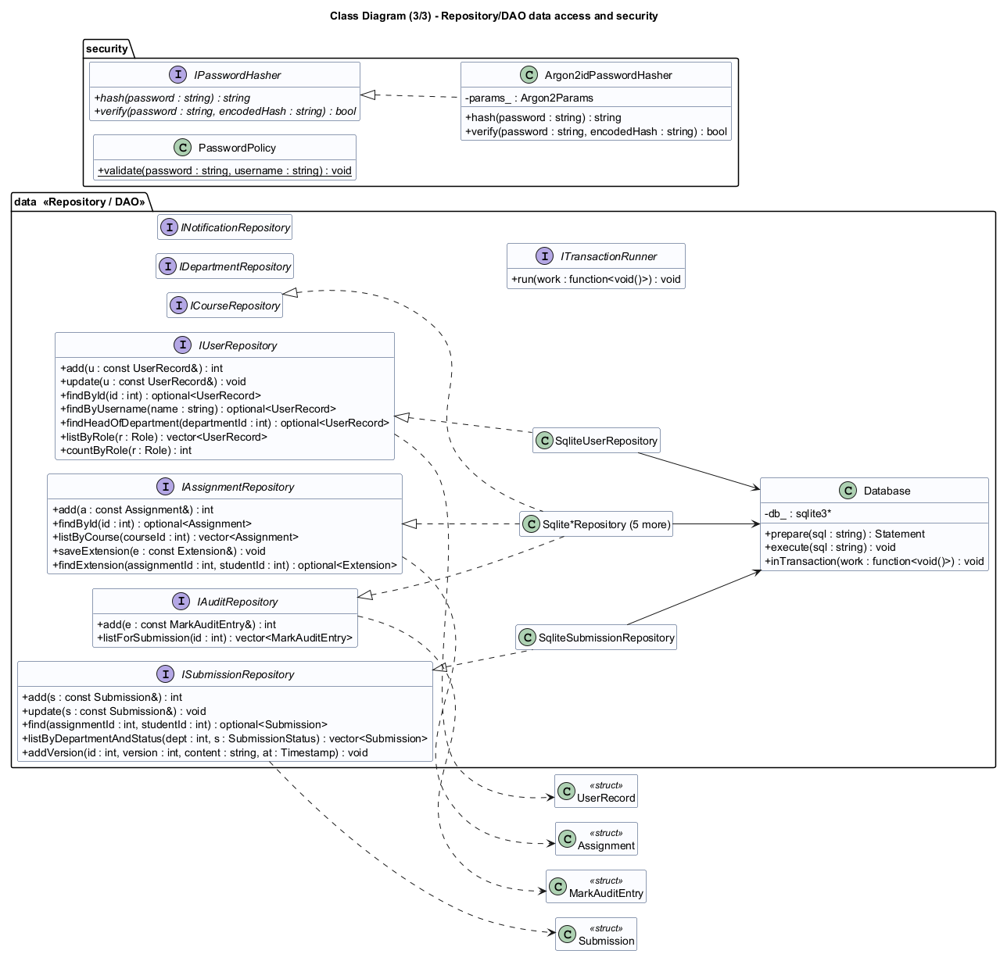

`User` is an abstract class with pure virtual functions for the role, its title, its permission set and its *department scope*. The four roles are `final` subclasses. Behaviour that differs by role is dispatched polymorphically rather than through conditionals on a role code. For example, `hasDepartmentScope(d)` returns true for every department for an Administrator, only the HoD's own department for a HoD, and false for everyone else, and the moderation service calls this without knowing which subclass it holds.

Five patterns are used, each chosen for a specific reason:

- **Strategy** for the late-penalty rule (`ILatePenaltyPolicy`, implemented by `PercentPerDayPenaltyPolicy(10 %, 3 days)` and `NoLatePenaltyPolicy`). The penalty was the most contested requirement and the one most likely to change. With a strategy the school can alter it, or waive it for a course, without editing the marking service, and a test swaps the strategy to prove that it is injectable.
- **Repository/DAO** for data access (seven small interfaces with SQLite implementations). It confines SQL to one file that can be inspected for injection safety, lets services be tested against an in-memory database, and would make a move to a server database local to one layer.
- **Factory Method** (`UserFactory`) is the single place that maps a stored role code to the right subclass; the authentication service returns a `unique_ptr<User>` without knowing the subclasses.
- **Observer** (`SubmissionEventPublisher` and `ISubmissionObserver`) decouples the services from notifications. Notifications were a Could requirement: they can be removed, or replaced by SMS later, without touching any service.
- **Template Method** (`RoleMenu::run`) fixes the skeleton of every session (greeting, notifications, menu loop and, above all, error handling) once, so every role gets identical robustness. Each subclass supplies only its title and items.

A composition root (`LmsSystem`) is the only place where concrete classes are chosen, which is what makes dependency injection work in the tests.

The design follows the **SOLID** principles (Martin, 2017). *Single responsibility:* `LatenessCalculator` only counts days late, the policy only turns days into a deduction, and `MarkingService` only orchestrates. *Open/closed:* new penalty rules, observers and schema changes are new classes or files, not edits. *Liskov substitution:* every policy and every `User` subclass is tested through its base type. *Interface segregation:* seven narrow repository interfaces rather than one "database" interface, and `IClock`, `IPasswordHasher` and `ITransactionRunner` each have one or two methods. *Dependency inversion:* services depend on abstractions that the data layer implements. One compromise was accepted deliberately: services receive the whole bundle of seven repository references even when they use three or four, trading a little interface segregation for short constructors. It is documented rather than hidden.

### 5.3 Behavioural models
The **state machine** (Figure 8) defines the submission life cycle: SUBMITTED or LATE, then MARKED, MODERATED and finally RELEASED. The guards map to business rules: resubmission is allowed only while the effective deadline has not passed, a re-mark needs a reason, and RELEASED is final. An extension can move a LATE submission back to SUBMITTED. The table of legal transitions is implemented in exactly one function and tested exhaustively (all 25 from/to pairs).

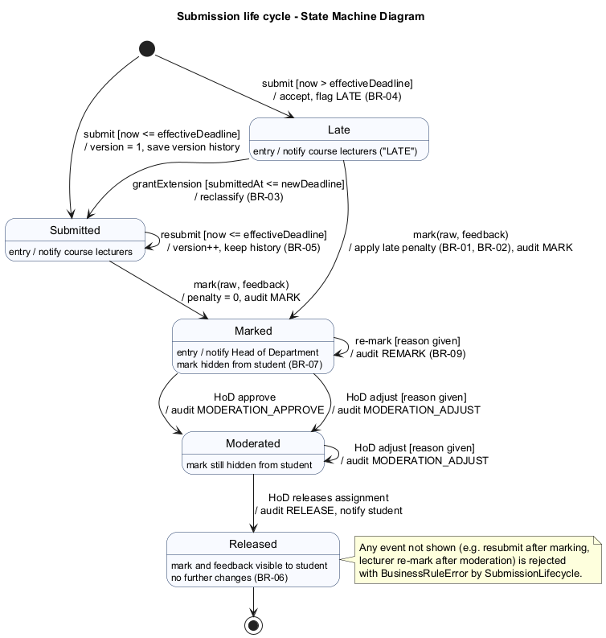

The **activity diagram** with swimlanes for Student, System, Lecturer and HoD (Figure 9) shows the end-to-end process from submission to released mark, including the resubmission and late branches, the optional extension and the moderation loop. The two **sequence diagrams** (Figures 10 and 11) show *Submit assignment*, with alternative fragments for the first, resubmitted, late and refused paths, and *Moderate and release marks*, with approve and adjust alternatives and the transactional release loop. They were used directly as the design of the service methods and as the basis for integration tests.

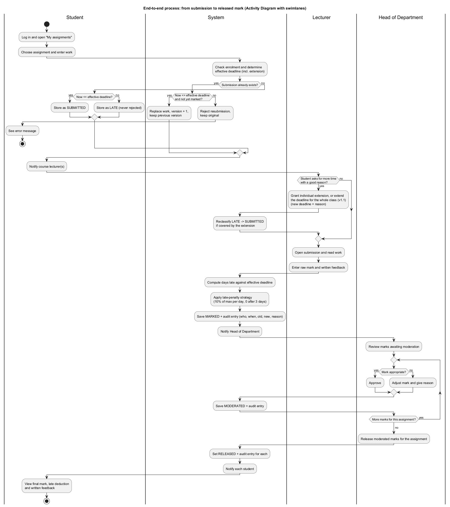

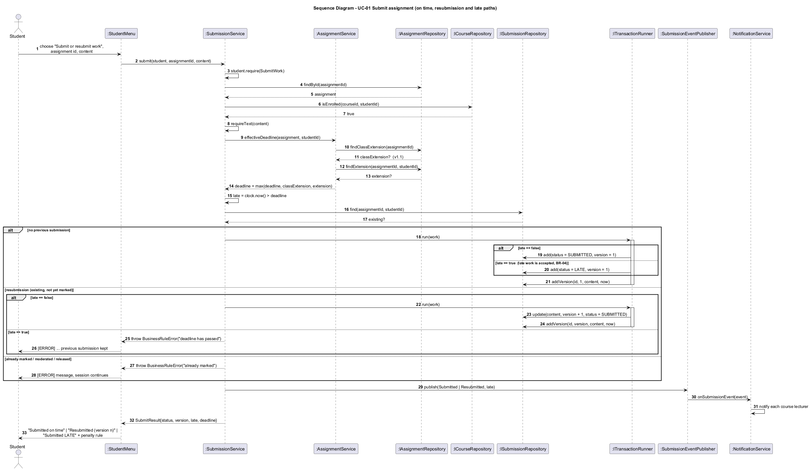

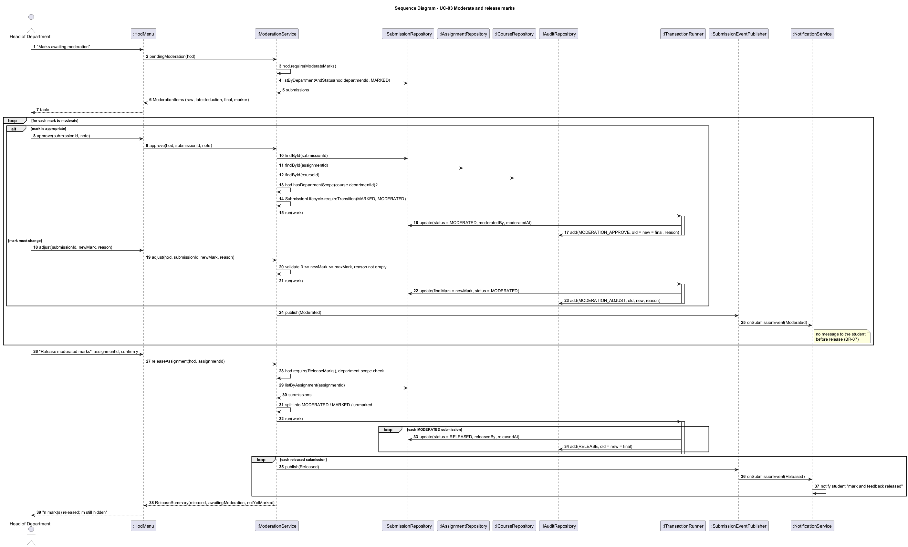

### 5.4 Database design
The ERD (Figure 12) has twelve tables in v1.1 and is normalised to third normal form. Many-to-many relationships (lecturers to courses, students to courses) are junction tables, and resubmission history is a separate table rather than a repeating group. No non-key attribute depends on another non-key attribute. The HoD of a department is not stored in `department`, because that would duplicate the user's role and department and could contradict it; a partial unique index instead enforces "at most one active HoD per department" directly on `app_user`.

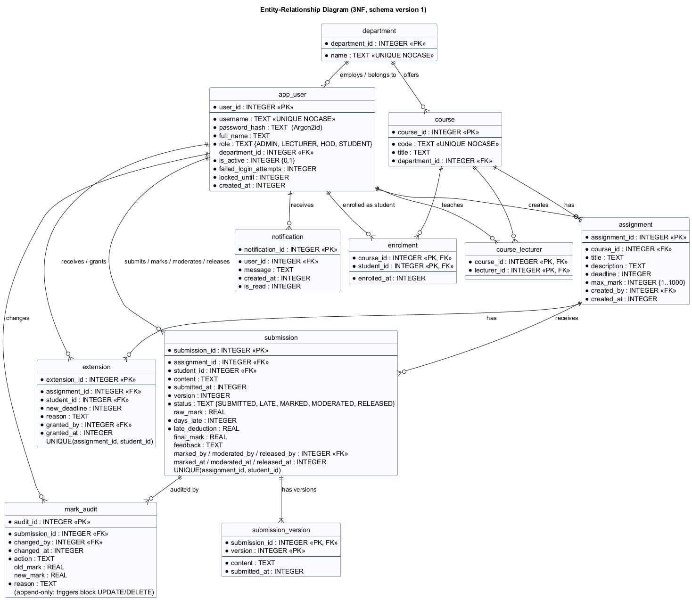

One attribute was examined closely as a possible transitive dependency: `submission.final_mark`. At marking time it equals the raw mark minus the late deduction, so it looks derivable. It is stored anyway for two reasons. After moderation the HoD may set a different value, so it becomes an independent fact. And an assessment record must not change silently if the penalty policy changes later, so the stored `days_late`, `late_deduction` and `final_mark` are the recorded decision that the audit log refers to.

The data dictionary, the full schema and the class-to-table mapping are in the SDD. The main mapping decision is **single-table inheritance** for users: the four subclasses add behaviour but no data, so one table with a role discriminator avoids four identical tables and a join at every login. Security-sensitive columns (the password hash and lockout counters) exist only in the persistence object `UserRecord` and never reach the user interface, which receives a separate `UserSummary`. Constraints are enforced in the database as well as in code: CHECK constraints on roles, statuses, mark ranges and the Argon2id hash prefix; foreign keys; uniqueness; and two triggers that make the audit table append-only. The schema lives in numbered SQL files that CMake embeds into the executable, so the documentation, the tests and the program cannot use different schemas.

## 6. Implementation

### 6.1 Structure
The code comprises about 4 800 non-blank lines of production C++ and SQL and 2 000 lines of tests. `lib/` holds the domain, services, policy, security and data-access code (the `lms_core` library); `app/` holds the console presentation layer; `sql/` holds the migrations; `tests/` holds the four test levels. The project builds with CMake. SQLite 3.46.1, the Argon2 reference implementation and GoogleTest are fetched by pinned URL and SHA-256, so every build is reproducible, and they can come from a local cache for offline builds. A documented coding standard (naming, RAII, no raw `new`, const-correctness, exception rules, security rules, complexity limits) is enforced partly by the compiler warning set and the static analysers.

### 6.2 Key decisions
**Time is an integer.** All timestamps are 64-bit seconds since the Unix epoch, and local time is used only for display and input. Deadline comparisons and day counting are therefore exact integer arithmetic, with no time-zone or daylight-saving ambiguity, which directly addressed risk R5. The clock is injected through an `IClock` interface, so tests can place "now" exactly one second after a deadline.

**The effective deadline is computed in exactly one place** (`AssignmentService::deadlineFor`). Submission, marking and listing all ask this method. This single decision is what made the maintenance change cheap (section 10).

**Lateness is evaluated at marking time**, against the effective deadline *then*. An extension granted after a late submission, for example once a power cut has been confirmed, therefore removes the penalty automatically, and the service also reclassifies any unmarked LATE submission the extension now covers.

**Errors are exceptions from one hierarchy** (`ValidationError`, `AuthorizationError`, `BusinessRuleError`, `NotFoundError`, `DatabaseError`). Every service entry point checks, in order, the actor's permission, their course or department scope, the input, and the business rule. Only then does it write, inside a transaction. The Template Method in the menu catches `LmsError` in one place, reports it in plain language and continues the session. The input layer re-prompts on malformed numbers and dates, and end of input exits cleanly. System tests prove that none of the exception flows terminates the program.

### 6.3 Security
Passwords are hashed with **Argon2id**, the winner of the Password Hashing Competition, standardised in RFC 9106 and recommended first by OWASP. It uses a 16-byte salt from the operating system's cryptographically secure generator (`BCryptGenRandom` on Windows, `/dev/urandom` elsewhere). The reference library was preferred to alternatives on stated grounds. bcrypt truncates passwords at 72 bytes and is not memory-hard. PBKDF2 is not memory-hard, so GPU attacks are cheap, and using it would mean building OpenSSL offline on Windows. libsodium would have been equally acceptable but is heavier to build. The encoded hash stores its own parameters, so they can be strengthened later.

Accounts lock for 15 minutes after five consecutive failures. The login error message is identical whether the username or the password was wrong. After the self code review (section 8) the *timing* is identical too: for an unknown user the service verifies the password against a dummy hash, so response time does not reveal which usernames exist. Passwords are read without echo. All SQL uses prepared statements with bound parameters, so injection payloads used as usernames simply fail to match, as a test demonstrates. Every service call checks role and scope, so the menus are a convenience, not the security boundary.

### 6.4 Persistence
Each connection enables foreign keys, write-ahead logging and a busy timeout. Transactions use nested SAVEPOINTs, so a service that calls another can safely nest a unit of work. A mark and its audit entry are always written in the same transaction, which is what makes the claim "every change is audited" true even when a write fails midway. Migrations are applied in order with `PRAGMA user_version`, and a database created by a newer release is refused rather than silently corrupted.

## 7. Verification and Validation

### 7.1 Strategy
The test plan maps each V-Model level to the artefact it verifies. **Unit tests** verify the detailed design: lateness, penalties, the user hierarchy and permissions, the state machine, hashing, the password policy, date parsing and the event publisher, with no database. **Integration tests** verify the architecture: the services running against real SQLite repositories in memory, including transactions, migrations, constraint enforcement and the observer. **System tests** verify the SRS by driving the real console application with scripted keyboard input, one test per use-case flow, together with performance tests with 800 students. **Acceptance tests** validate stakeholder needs by running the packaged executable against a fresh demonstration database. Each level has entry and exit criteria; for example, integration testing starts only when unit tests pass and ends when all integration tests pass with coverage of at least 70 %.

### 7.2 Test design
Test cases were derived systematically (Myers, Sandler and Badgett, 2011). For **lateness**, the input domain was partitioned into on time, day 1, days 2-3 and more than three days, and tests sit on both sides of every boundary: one second early, exactly at the deadline, one second late, exactly 24 hours, 24 hours plus one second, and so on up to 72 hours plus one second. For **penalties**, partitions cover no penalty, the lowest and highest penalised days, the zero partition, the cap at the raw mark, the boundaries of the mark range and invalid values (above the maximum, negative, NaN). Similar boundary tables cover password length (7, 8, 128, 129), username length, maximum mark, submission and feedback sizes, the lockout threshold (four failures versus five) and the lockout duration (one second before and exactly at 15 minutes). **State-transition testing** covers all 25 transitions of the submission state machine, and a **decision table** covers all 52 role-permission combinations.

### 7.3 Results
Table 3 summarises the automated results for v1.0 (the v1.1 regression results are in section 10).

| Level | Tests | Passed |
|-------|------:|-------:|
| Unit | 145 | 145 |
| Integration | 92 | 92 |
| System (ST01-ST27) | 27 | 27 |
| Performance (NFR-01..03) | 5 | 5 |
| Acceptance scenarios (AT-01..05) | 4 | 4 |

*Table 3 - Test results for release v1.0 (evidence in `docs/07-testing/reports`).*

All functional tests pass with two compilers: GCC 16 with warnings as errors, and Clang 21. **Line coverage of the business-logic layer is 95.9 %** (function coverage 94.9 %), against a target of 70 %. The uncovered lines are mainly SQLite bind-failure paths that cannot be reached with valid statements and the production factory used only by the executable. Branch coverage (59 %) is reported but not targeted, because GCC counts the hidden exception-handling branches the compiler generates for every call that can throw. The performance requirements were met with wide margins: login 153 ms (limit 2 s), assignment list 2.6 ms, submission 1.9 ms, a moderation queue of 800 items in 108 ms, and releasing 800 marks in 338 ms.

The acceptance run produced an instructive observation. The demonstration assignment's deadline was exactly two days before the submission, which was made a few seconds later, so the work counted as three started days late and lost 30 %. This is exactly what BR-02 specifies, but users might not expect it, and the student manual now explains the rule with a worked table. One acceptance test, AT-06 (a first-time student completes a submission within two minutes using the manual), needs a real volunteer and has **not yet been executed**; this is stated in the test report rather than claimed.

### 7.4 Defects
Eight defects were logged, with severity, how each was found, its cause, the fix (commit) and the retest result (Appendix B). Three are worth discussing. **DEF-01** was found by a unit test: the penalty policy accepted NaN, because `raw < 0 || raw > max` is false for NaN. The fix rewrote the check in the positive form, and a coding-standard rule now requires it. Later, clang-tidy recommended "simplifying" that same expression back to the defective form. The suggestion was rejected with a documented suppression, a small example of why tool advice needs engineering judgement. **DEF-04** and **DEF-05** were security defects found by *review*, not testing: the login timing side channel, and a file submission path that could have submitted the LMS database itself, exposing all marks and password hashes to a lecturer. That two of the most serious defects escaped 260 tests supports keeping a review checklist alongside automation.

## 8. Configuration Management and Quality Assurance

### 8.1 Configuration management
Every configuration item is under Git: code, migrations, build scripts, CI definition, tool profiles and every document and diagram source. Third-party code is identified exactly (version and hash) rather than copied. The branching strategy is **GitHub Flow with release tags**. `main` is always releasable, and every change arrives from a short-lived `feature/`, `fix/` or `docs/` branch through a merge commit, so the history shows each unit of work (Figure 13 shows the shape). Git Flow was considered and rejected: permanent `develop` and `release` branches would double the merges for a single developer with two planned releases without adding any gate that CI and tags do not already provide. Commits follow a conventional format and cite requirement and defect IDs, for example `fix(policy): reject NaN raw marks in the penalty policy (DEF-01)`. Releases are annotated tags `v1.0` and `v1.1`, and the version number is defined once in CMake and propagated to the program and the package name.

```
*   Merge branch 'feature/cr1-class-extension'        (tag v1.1)
|\  docs(cr1) update affected documents / feat(cr1) class-wide extensions / docs(cr1) impact analysis
*   Merge branch 'docs/v1.0-deliverables'             (tag v1.0)
*   Merge branch 'fix/code-review-findings'   refactor: review, static-analysis and metrics fixes; DEF-03
*   Merge branch 'feature/ci'  ...  'feature/automated-tests' (fix DEF-01) ... 'feature/build-setup'
```
*Figure 13 - Shape of the Git history (`git log --graph`).*

The **CI pipeline** (GitHub Actions) runs on every push and pull request. It builds Debug and Release configurations on Ubuntu and Windows, with warnings as errors on Linux; runs all functional tests, and the performance tests in Release; fails if line coverage of `lib/` drops below 70 %; fails on any cppcheck finding; publishes the clang-tidy report; and, for version tags, builds a self-contained Windows ZIP with CPack and attaches it to a GitHub release. One honest limitation: the development PC had no GitHub remote during the project (risk R13), so every CI job was reproduced locally with the same compilers and flags. The actual GitHub Actions evidence is produced when the repository is pushed.

### 8.2 Quality assurance
**Static analysis** used two tools. cppcheck initially reported 16 style and performance findings. The genuine ones (names shadowing the menu's own `title()` method, a structure passed by value) were fixed; nine suggestions to replace readable loops with algorithms were consciously declined and suppressed with a reason. clang-tidy, with a broad profile, reported 59 findings. Most were fixed, including two real robustness defects: an unchecked return value from the time-conversion function and an optional value accessed without an explicit check. Two were kept with documented justifications: a `reinterpret_cast` required by SQLite's C API, and an empty catch that preserves the original exception during rollback. Both analysers now report zero findings.

**Metrics** were collected with lizard. The production code has 274 functions with an average cyclomatic complexity of 2.8 (McCabe, 1976). Two functions exceeded the limit of 15 set in the coding standard, the date parser (19) and the notification dispatcher (16); both were refactored into helpers, and the maximum is now 14, a flat switch that maps permissions to text. The key business functions (`submit`, `mark`, `daysLate`) stay below 10.

A **self code review** against a 16-point checklist (permission checks first, scope checks, bound SQL, no secrets in the UI, atomic mark-plus-audit, NaN-safe ranges, bounded input, timing-safe login, complexity, naming, consistency with the class diagram) found five issues that led to changes and four that were accepted with reasons. For example, an N+1 query pattern in the moderation queue was kept because it measured 108 ms for 800 items against a 2 s limit, and optimising it would have complicated the repository interface for no user-visible gain. The review also found that `DirectoryService` existed in the code but not in the class diagram; the diagram was corrected, which is what the brief's consistency requirement asks for.

## 9. Deployment

The deployment diagram (Figure 14) shows the intended configuration: one school computer running a single statically linked executable that contains the business logic, SQLite and Argon2. It works with one database file in write-ahead-log mode and a daily copy to a backup drive, and no network connection is required. Static linking of the C/C++ runtime (a build option used by the release job) means the school does not need to install a Visual C++ redistributable.

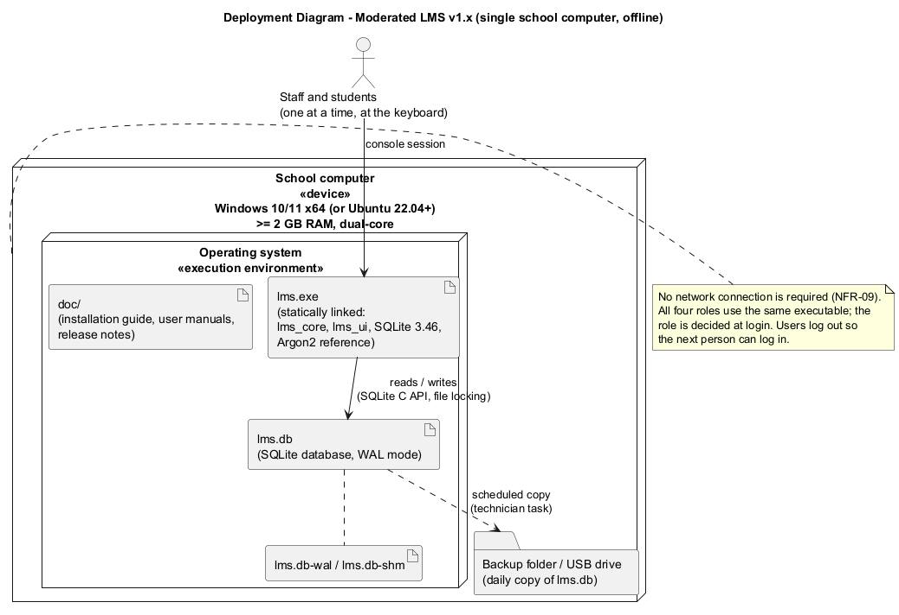

The **installation guide** is written for a school technician rather than a developer. It gives numbered steps for extracting the ZIP, creating a data folder and a desktop shortcut, protecting the folder, creating the first administrator on first start, and training with a separate demonstration database. It explains backup and restore, including a Task Scheduler recipe, and in-place upgrades. It lists what must not be done (a network share, editing the database, changing the clock) and includes a troubleshooting table. A **user manual for each role** explains the menu options in the users' language, with worked examples of the late-penalty rule for students. **Release notes** list features, security measures, quality figures and known limitations. The release was tagged `v1.0`, and CPack produces `ModeratedLMS-1.x.x-Windows.zip` containing the executable and the documentation.

## 10. Maintenance: Change Request CR1

After release the school requested: *"A lecturer should be able to extend the deadline for a whole class, not just an individual student, and extensions should be shown on the student's assignment list."*

**Classification.** The change is **perfective maintenance** in the sense of Lientz and Swanson (1980) and ISO/IEC/IEEE 14764. It is not corrective, because v1.0 met its specification (FR-08 asked only for individual extensions) and no defect is involved. It is not adaptive, because nothing in the environment changed. It is not preventive, because its purpose is not to ease future maintenance. Users are asking for new functionality and better presentation of existing information after using the system. It has a small adaptive element: existing v1.0 databases must be upgraded in place without losing data.

**Clarification and impact analysis.** Before any code was written, the request was clarified. A "whole class" is everyone enrolled on the course. There is one class extension per assignment, and granting it again replaces the previous one. The student's effective deadline becomes the *latest* of the original deadline, the class extension and their own extension, so neither kind can shorten the other. The change is refused once moderation has begun, consistent with the rule for individual extensions. The impact analysis then listed every affected artefact:
- requirements FR-09 and FR-19, business rule BR-03 and the new FR-22;
- use cases (new UC-16) and all class views, the ERD, the state machine, the activity diagram and the submit sequence diagram (the component and deployment diagrams are unaffected);
- about a dozen named source files;
- one new table, `class_extension`, as an additive migration;
- tests: the analysis predicted that exactly one existing system test (ST22) would fail because it checked the v1.0 display text "(extended)", and it listed the new tests needed.

**Implementation.** The change was made on its own branch, in three commits (analysis, code and tests, updated documents), and released as `v1.1`. The layered design and the single effective-deadline method paid off: late status, penalties, resubmission windows and reclassification all started respecting class extensions **without any change to the submission or marking services**. The lecturer menu gained one option, and the student list gained *Original deadline* and *Extension* columns.

**Regression testing.** The existing suite was first run unchanged against the new code: 263 of 264 passed, and the single failure was ST22, exactly as predicted, for an intended display change rather than a behavioural regression. After that expectation was updated, 14 new tests were added: 11 integration tests for the rules above (including both orders of individual and class extensions, boundary values, reclassification, refusal after moderation, penalty removal and notifications); a test that builds a genuine v1.0 schema with data and verifies the upgrade to schema version 2 without loss; and two system tests. The full suite of **278 tests passed** on both compilers, the performance and acceptance tests passed (including a new acceptance scenario for the class extension), coverage rose to 96.1 %, and the static analysers reported no findings.

## 11. Professional, Legal and Ethical Issues

**Data protection.** The system processes personal information about learners, most of them minors: names, their work, marks and feedback. The Lesotho Data Protection Act 2011 requires such information to be processed lawfully, for a specific purpose, adequately and not excessively, accurately, securely, and not kept longer than necessary, and it gives data subjects rights of access and correction. The school is the data controller. The design supports these duties by construction. It stores no more than assessment needs: no identity numbers, addresses or birth dates. Access is restricted by role and scope in every service call, and students see only their own work. Everything stays on the school's computer, so nothing is transferred across borders. Records are deactivated rather than deleted, so decisions can be checked on appeal. Some duties can only be met by the school, and the report says so rather than implying the software discharges them: a retention period, archiving data of learners who have left, physical security of the PC, encryption of backup drives, and informing parents. Two technical limitations are declared openly: the database file itself is not encrypted, and passwords exist briefly in ordinary memory during login. Both are proportionate risks for a single offline computer, and both have known remedies for a future version.

**Security of assessment records.** Marks affect progression and reputations, so the system treats them as evidence. Separation of duties (the lecturer marks, the HoD moderates and releases, neither can do the other's step), the state machine that makes released marks final, and an audit log that the database itself refuses to update or delete together mean that a disputed mark can be traced to a person, a time and a stated reason.

**Accessibility.** A plain-text console is, perhaps surprisingly, a good basis for accessibility. Screen readers such as NVDA and Narrator read it, nothing is conveyed by colour alone, users can enlarge the text through the console's own settings, and the interface is keyboard-only with no time pressure. Cognitive load is limited by short numbered menus and error messages that say what to do. Individual extensions give learners who need extra time a recorded, private mechanism. The limits are acknowledged: long tables are tedious to hear read aloud, and the usability acceptance test with real users is still outstanding.

**Fairness of the late penalty.** The rule is the HoD's policy. The software's ethical obligation is to apply it consistently, transparently and without hidden harshness. One implementation, tested at every boundary, replaces manual arithmetic that varied between lecturers. The rule is shown to students at the moment they submit late and is explained with examples in their manual, so no one is penalised by a rule they could not know. The deduction is proportional to the maximum mark and capped at the student's mark. Late work is always marked with feedback. The "started 24-hour period" definition has a harsh edge (one second past 24 hours counts as two days), but the alternative rewards lateness, and the chosen rule is at least predictable. In a context of unreliable electricity and shared computers, lateness is not always the learner's fault, so the design deliberately makes compassion easy but visible: extensions and moderation adjustments are available, but each requires a reason and leaves a trace. Because the rule is a Strategy, the school can adopt a gentler policy without rewriting the system.

**Professional conduct.** Following the ACM/IEEE Software Engineering Code of Ethics, the documents report what was not verified as clearly as what was: the pending usability test, CI not yet run on GitHub, and the gap between the plan and the actual timeline. All third-party components are used within their licences and are attributed. Where AI assistance was used in producing code or documents, the student remains responsible for understanding and being able to explain every part at the viva, and commits made with assistance record it.

## 12. Conclusion

The project delivered a working, tested and documented moderated LMS that meets every Must requirement, together with the complete chain of artefacts the Waterfall and V-Model processes require: plan, specification, design, code, tests, quality records, deployment material and a maintained second release. The strongest evidence that the engineering decisions were sound comes from the maintenance phase. A change that touched the central concept of the deadline was absorbed by one service method and one additive table, while the existing tests confirmed nothing else moved.

The project also taught lessons that should be stated critically. First, **resolving conflicts by looking for the need behind each statement** (speed for the lecturer, not rejecting work for the students) produced better requirements than choosing a winner. Second, **tests, reviews and tools find different defects**: a unit test found the NaN defect, a review found both security defects, a second compiler found the build defect, and a static analyser both found real problems and once gave wrong advice. None of these techniques would have been sufficient alone. Third, **Waterfall's rigidity was mitigated rather than eliminated.** Explicit gates and traceability kept the artefacts consistent, but the real timeline was more compressed than the plan, and the documents record that honestly rather than reconstructing an idealised history.

The main limitations are the single-computer deployment, the unencrypted database file, the outstanding usability test and CI that has not yet run on GitHub. Future work, in order of value to the school, would be: a client-server version for several computers; encryption at rest (SQLCipher); a controlled procedure for correcting released marks; and export of results for reporting to parents and the ministry.

## 13. References

ACM/IEEE-CS Joint Task Force (1999) *Software Engineering Code of Ethics and Professional Practice*, version 5.2. New York: ACM.

Biryukov, A., Dinu, D., Khovratovich, D. and Josefsson, S. (2021) *RFC 9106: Argon2 Memory-Hard Function for Password Hashing and Proof-of-Work Applications*. Internet Engineering Task Force. Available at: https://www.rfc-editor.org/rfc/rfc9106 (Accessed: 28 September 2026).

Cockburn, A. (2001) *Writing Effective Use Cases*. Boston: Addison-Wesley.

Elmasri, R. and Navathe, S.B. (2016) *Fundamentals of Database Systems*. 7th edn. Harlow: Pearson.

Forsberg, K. and Mooz, H. (1991) 'The relationship of system engineering to the project cycle', *Proceedings of the First Annual Symposium of the National Council on Systems Engineering*, pp. 57-65.

Fowler, M. (2002) *Patterns of Enterprise Application Architecture*. Boston: Addison-Wesley.

Gamma, E., Helm, R., Johnson, R. and Vlissides, J. (1994) *Design Patterns: Elements of Reusable Object-Oriented Software*. Reading, MA: Addison-Wesley.

Government of Lesotho (2011) *Data Protection Act, 2011 (Act No. 5 of 2011)*. Maseru: Government Printer.

ISO/IEC/IEEE (2018) *ISO/IEC/IEEE 29148:2018 Systems and software engineering - Life cycle processes - Requirements engineering*. Geneva: International Organization for Standardization.

ISO/IEC/IEEE (2022) *ISO/IEC/IEEE 14764:2022 Software engineering - Software life cycle processes - Maintenance*. Geneva: International Organization for Standardization.

Lientz, B.P. and Swanson, E.B. (1980) *Software Maintenance Management*. Reading, MA: Addison-Wesley.

Martin, R.C. (2017) *Clean Architecture: A Craftsman's Guide to Software Structure and Design*. Boston: Prentice Hall.

McCabe, T.J. (1976) 'A complexity measure', *IEEE Transactions on Software Engineering*, SE-2(4), pp. 308-320.

Myers, G.J., Sandler, C. and Badgett, T. (2011) *The Art of Software Testing*. 3rd edn. Hoboken, NJ: Wiley.

OWASP Foundation (2024) *Password Storage Cheat Sheet*. Available at: https://cheatsheetseries.owasp.org/cheatsheets/Password_Storage_Cheat_Sheet.html (Accessed: 28 September 2026).

Royce, W.W. (1970) 'Managing the development of large software systems', *Proceedings of IEEE WESCON*, 26, pp. 1-9.

Sommerville, I. (2016) *Software Engineering*. 10th edn. Harlow: Pearson.

SQLite Consortium (2024) *Appropriate Uses For SQLite*. Available at: https://www.sqlite.org/whentouse.html (Accessed: 28 September 2026).

Stroustrup, B. and Sutter, H. (eds.) (2024) *C++ Core Guidelines*. Available at: https://isocpp.github.io/CppCoreGuidelines/ (Accessed: 28 September 2026).

W3C (2023) *Web Content Accessibility Guidelines (WCAG) 2.2*. Available at: https://www.w3.org/TR/WCAG22/ (Accessed: 28 September 2026).
